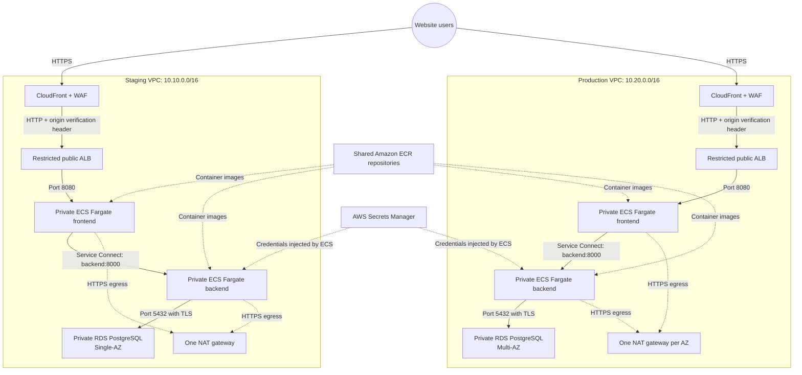
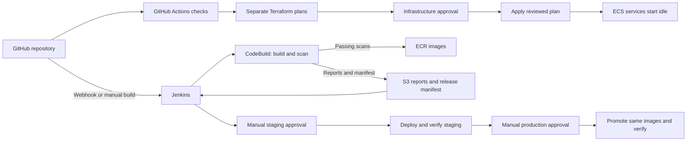

WebTech: AWS Infrastructure and Jenkins CI/CD Pipeline
A learning project that provisions separate staging and production environments with Terraform, then builds, scans, and deploys a containerised web application through Jenkins.
Project status: This repository describes a learning implementation. Terraform files do not mean the AWS resources are currently deployed. Read Security and limitations before using it as a production design.

What the project contains
- Frontend: HTML served by Nginx.
- Backend: Python FastAPI.
- Database: Amazon RDS for PostgreSQL.
- Runtime: Amazon ECS on AWS Fargate.
- Image registry: Amazon ECR.
- Image build and scan: AWS CodeBuild.
- Infrastructure: Terraform, provisioned by GitHub Actions.
- Application delivery: Jenkins, with separate manual approvals for staging and production.
- Environments: Independent staging and production VPCs, application services, databases, and ingress resources in eu-west-2 (London).
Architecture design
Application and network architecture

Request path: User -> CloudFront/WAF -> ALB -> Nginx frontend -> FastAPI backend (when needed) -> PostgreSQL.

The ALB accepts CloudFront origin-facing traffic and checks an origin verification header. Application tasks and databases run without public IP addresses. The application subnets use NAT for outbound access; the data subnets have no default internet route. Security groups restrict traffic between the ALB, frontend, backend, and database tiers.
Infrastructure and application delivery
Infrastructure provisioning and application delivery are separate workflows. Jenkins does not automatically wait for a GitHub Actions infrastructure run to finish.

Terraform creates fresh ECS services with zero desired tasks, an intentionally unpullable placeholder image, and suspended autoscaling. After approval, Jenkins deploys immutable image digests from the release manifest, starts the services, waits for ECS stability, runs smoke tests, and activates autoscaling after successful verification. Production promotes the same images that were verified in staging.
Environment overview
Setting	Staging	Production
VPC CIDR	10.10.0.0/16	10.20.0.0/16
Availability Zones	Two	Two
NAT gateways	One	One per AZ
Database	RDS PostgreSQL, Single-AZ	RDS PostgreSQL, Multi-AZ
Initial ECS task count	Zero	Zero
Minimum tasks after release	One per service	Two per service
Maximum tasks	Two per service	Six per service
Database backup retention	One day	One day
Application log retention	14 days	30 days

These are repository configuration values, not a claim that the environments are currently running. The project configuration uses db.t3.micro and 20 GiB gp3 database storage, with autoscaling up to 50 GiB; review sizing and cost before deployment.
Repository layout
.
├── .github/
│   ├── workflows/                 # Security checks and Terraform stack workflows
│   └── scripts/                   # Report generation
├── app/
│   ├── frontend/                  # Nginx and static HTML
│   ├── backend/                   # FastAPI service
│   └── docker-compose.yml         # Local application stack
├── ci/                            # Build, release, deployment, and smoke-test scripts
├── jenkins/                       # Jenkins container configuration and plugins
└── infra/terraform/
    ├── bootstrap/                 # Remote state prerequisites
    ├── shared/                    # Shared AWS resources
    ├── environments/
    │   ├── staging/
    │   └── production/
    ├── modules/                   # Network, ECS, database, ingress, observability
    └── iam/                       # GitHub and deployment role guidance
Getting started
Prerequisites
- An authorised AWS provisioning identity and access to the intended AWS account.
- Git and Docker Engine with Docker Compose v2.
- Python 3.12 for local backend checks.
- Terraform for local validation and review.
- GitHub access to configure Actions environments, secrets, and approvals.
- Jenkins configured with the required AWS credentials/roles and job parameters.
Never commit AWS credentials, database passwords, Terraform state, or release secrets to Git.
Run the application locally
From the repository root:
docker compose -f app/docker-compose.yml up -d --build
The local Compose stack starts PostgreSQL, the backend, and the Nginx frontend. The project guide uses http://localhost:8080 for the local application. Check the Compose file for the current port mappings and health checks.

Stop the stack with:
docker compose -f app/docker-compose.yml down
Provision AWS infrastructure
Use the GitHub Actions Terraform workflows and their protected environments to review and apply the bootstrap, shared, staging, and production stacks. Each stack has its own state and approval. Review the generated plan, account, region, networking, IAM permissions, database settings, and expected costs before approving an apply.

The environment configuration is under:
infra/terraform/environments/staging/terraform.tfvars
infra/terraform/environments/production/terraform.tfvars
Configure and run Jenkins releases
Configure Jenkins with the repository's required credentials, AWS role access, environment parameters, and approval users. A build can start from the configured GitHub webhook or manually. Confirm the correct commit and environment before approving a deployment. Jenkins builds and scans images through CodeBuild, publishes passing images to ECR, records a release manifest in S3, deploys to staging, runs verification, then waits for a separate production approval.
Security and operational controls
The project includes private application and database subnets, tiered security groups, CloudFront origin restrictions, WAF managed rules, non-root application containers, encrypted RDS and logs, Secrets Manager integration, immutable image digests, scan gates, and separate infrastructure and application approvals.

Monitoring and operational visibility include ECS application logs, VPC flow logs, RDS logs and enhanced monitoring, ALB access logs, WAF logs, and production ECS Container Insights. Jenkins build artifacts and S3 reports contain release manifests and scan results. A passing image scan is a gate against configured severities; it does not prove that an image has no vulnerabilities.
Security and limitations
This is a learning implementation. Review the current Terraform, IAM policies, AWS account, and actual deployed state before use.
- CloudFront-to-ALB and ALB-to-frontend traffic use HTTP; user-to-CloudFront traffic uses HTTPS. End-to-end TLS is not configured.
- The learning Jenkins identity previously used broad permissions. Replace it with scoped roles and short-lived credentials.
- The application uses the RDS-managed master credential; production should use a limited application database user.
- Database tables are created at application startup; controlled schema migrations are not implemented.
- Python dependency ranges and mutable base image tags limit build reproducibility.
- Automated disaster recovery exercises, load testing, blue/green releases, and coordinated application/database rollback are not included.
- Multi-AZ databases and multiple tasks do not by themselves prove an application SLA.
- Zero ECS tasks do not make the AWS environment free. RDS, NAT gateways, load balancers, WAF, logs, and storage may still incur charges.
- Destruction can permanently remove data. Review a saved destroy plan and database snapshot requirements; do not destroy the bootstrap state bucket as part of an application environment teardown.
Troubleshooting and further guides
Start with the specific Jenkins build's artifacts and matching CodeBuild CloudWatch log stream. Read the lines immediately before the final failure message; an exit status 1 only says a command failed. Common issues include missing GitHub environment role secrets, OIDC subject or audience mismatch, S3 state-lock permissions, IAM scope for service APIs, and Trivy findings blocking image publication.

For detailed commands and repository-specific setup, see:
- [Application guide](app/README.md)
- [Jenkins setup](jenkins/README.md)
- [CI/CD guide](ci/README.md)
- [Deployment flow](ci/DEPLOYMENT_FLOW.md)
- [Terraform guide](infra/terraform/README.md)
- [GitHub OIDC and approvals](infra/terraform/GITHUB_AWS_ROLE_SETUP.md)
- [IAM policy guide](infra/terraform/iam/README.md)
