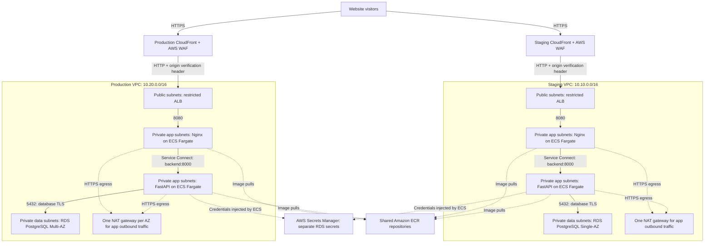
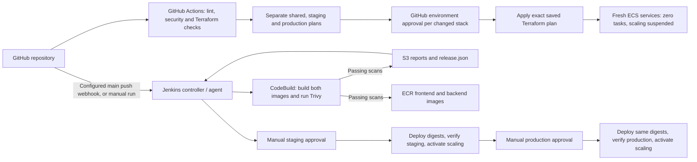

# WebTech: Terraform Infrastructure and Jenkins Application Delivery

A learning project that provisions isolated staging and production environments
on AWS, then builds, scans and deploys a containerised application through Jenkins.

The application is an enquiry website: Nginx serves the frontend, FastAPI validates
submissions, and PostgreSQL stores names and email addresses. AWS CodeBuild builds
the frontend and backend images. Jenkins promotes the **same image digests** from
staging to production after separate manual approvals.

**Infrastructure approval and application approval are separate.** Terraform creates
ECS services with **zero running tasks** and suspended autoscaling. A successful
infrastructure apply alone does not launch the application. Jenkins starts each
environment only after its release approval.

> This is a learning implementation, not a production security baseline. See
> [Security and limitations](#security-and-limitations) before adapting it.
> Staging, production and shared application resources were torn down during the
> October 2026 learning sessions. The configuration remains available for
> reprovisioning; previous CloudFront addresses must not be treated as live URLs.

## Contents

- [Architecture design](#architecture-design)
- [Ownership and approval boundaries](#ownership-and-approval-boundaries)
- [Environment design and autoscaling](#environment-design-and-autoscaling)
- [Repository structure](#repository-structure)
- [Terraform state design](#terraform-state-design)
- [Prerequisites](#prerequisites)
- [Run the application locally](#run-the-application-locally)
- [Provision AWS infrastructure](#provision-aws-infrastructure)
- [Configure Jenkins](#configure-jenkins)
- [Build, approve and promote a release](#build-approve-and-promote-a-release)
- [Reports and observability](#reports-and-observability)
- [Testing and validation](#testing-and-validation)
- [Troubleshooting](#troubleshooting)
- [Pause, destroy and reprovision](#pause-destroy-and-reprovision)
- [Security and limitations](#security-and-limitations)
- [Further documentation](#further-documentation)

## Architecture design

### Application runtime

The main infrastructure region is **eu-west-2 (London)**. Staging and production
have separate VPCs, ECS clusters/services, databases, load balancers, CloudFront
distributions and WAF web ACLs. Each VPC spans `eu-west-2a` and `eu-west-2b`.
CloudFront-scoped WAF resources use the provider alias in `us-east-1`.



The public ALBs accept traffic from the CloudFront origin-facing managed prefix
list. Listener rules also require the environment's `X-Origin-Verify` header.
Frontend tasks accept traffic from their ALB security group; backend tasks accept
frontend traffic; PostgreSQL accepts backend traffic. Application tasks and RDS
have no public IP addresses. Data subnets have no default internet route.

The browser uses one website address. Nginx forwards `/healthz` and `/api/*` to
`backend:8000`, supplied through ECS Service Connect and Cloud Map. NAT gateways
provide outbound connectivity for private application tasks to reach AWS APIs.

CloudFront supplies an AWS-generated `*.cloudfront.net` address. Terraform exposes
that address through the environment's `jenkins_parameters` output; Jenkins uses
it for deployment verification. Jenkins does not create the website address.

### Build and delivery architecture



GitHub Actions and Jenkins are independent execution systems. A main push can
trigger both when the Jenkins webhook is configured. Jenkins does **not** wait
for GitHub infrastructure approvals or workflow completion. Provision and
configure both environments before a normal application release. Protect `main`
with the desired PR reviews and CI checks.

## Ownership and approval boundaries

| System | Responsibility | Approval location |
| --- | --- | --- |
| GitHub Actions + Terraform | Shared ECR, CodeBuild and report infrastructure | `terraform-shared` GitHub environment |
| GitHub Actions + Terraform | Staging infrastructure | `terraform-staging` GitHub environment |
| GitHub Actions + Terraform | Production infrastructure | `terraform-production` GitHub environment |
| Jenkins | Build, scan and publish release images | Automatic build steps; security gate must pass |
| Jenkins | First staging launch and later staging releases | Jenkins staging input prompt |
| Jenkins | Promote the verified release to production | Separate Jenkins production input prompt |

A merge or approved PR does not itself count as an infrastructure apply approval.
Configure **required reviewers** and **main-only deployment rules** on all three
GitHub environments. Merely naming an environment in YAML does not enforce review.

Each enabled Terraform root has its own plan artifact and apply job. PRs never
apply. A no-change plan skips apply. The apply job verifies the saved plan's commit
and stack, rejects a superseded main commit, and downloads the plan by artifact ID.
Per-stack concurrency covers planning through approval/apply; S3 locking remains enabled.

Terraform preserves the application revision and runtime task count managed by
Jenkins/autoscaling. It also preserves the activated scaling minimum and suspension
state. The configured maximum and `ReleaseMinCapacity` tag remain infrastructure
settings; Jenkins reads the tag when activating an approved release.

These are workflow ownership boundaries, not proof that every IAM identity has
strictly isolated permissions. See the security notes and policy setup guides.

## Environment design and autoscaling

| Setting | Staging | Production |
| --- | --- | --- |
| VPC CIDR | `10.10.0.0/16` | `10.20.0.0/16` |
| Availability zones | Two | Two |
| Subnets | Two public, two app, two data | Two public, two app, two data |
| NAT gateways | One shared by the app subnets | Two, one per AZ |
| ECS launch type | Fargate | Fargate |
| Tasks immediately after fresh Terraform provisioning | Zero per service | Zero per service |
| Minimum after an approved, verified release | One per service | Two per service |
| Scaling maximum | Two per service | Six per service |
| Task CPU / memory | 0.5 vCPU / 1 GiB | 0.5 vCPU / 1 GiB |
| RDS | PostgreSQL 18.3, `db.t3.micro`, Single-AZ | PostgreSQL 18.3, `db.t3.micro`, Multi-AZ |
| Database storage | 20 GiB gp3; autoscaling limit 50 GiB | 20 GiB gp3; autoscaling limit 50 GiB |
| Database backup retention | One day | One day |
| Application log retention | 14 days | 30 days |
| ECS Container Insights | Disabled | Enabled |

Values above describe the repository configuration, not a live inventory.
Environment sizing is in each root's `terraform.tfvars`; image inputs are not needed.

### How scaling works

This project uses **ECS Service Auto Scaling**, not an EC2 Auto Scaling Group.
AWS manages the servers underlying Fargate. Frontend and backend scale independently.

- CPU target: **60%** service-average utilisation.
- Memory target: **70%** service-average utilisation.
- Scale-out cooldown: **60 seconds**.
- Scale-in cooldown: **300 seconds**.
- Either target-tracking policy can request scale-out; scale-in requires agreement
  from the policies that allow scale-in.

Fresh targets have minimum capacity zero and all scaling suspended. After manual
approval, Jenkins starts idle services at the configured release minimum. Only
after ECS stability and smoke tests succeed does it raise the scaling minimum
and resume scaling. A failed first release never enables scaling, but its attempted
tasks can remain running for investigation. Existing active scaling is left intact
if a later release fails verification.

Later releases preserve a nonzero desired count chosen by autoscaling. Deployment
surge settings can temporarily create more tasks than the steady-state scaling
maximum. Application autoscaling does not change RDS instance size; database
capacity and connection limits require separate consideration.

## Repository structure

```text
jenkins-pipeline/
├── README.md                         # Project guide and architecture
├── Jenkinsfile                       # Build and manually approved application releases
├── buildspec.yml                     # CodeBuild entry point
├── .github/
│   ├── workflows/
│   │   ├── security-scan.yml          # Checks and separate Terraform stack branches
│   │   └── terraform-stack.yml        # Reusable plan and protected apply workflow
│   └── scripts/render_report.py       # Render GitHub scan reports
├── app/
│   ├── frontend/                     # Nginx Dockerfile, HTML and proxy configuration
│   ├── backend/                      # FastAPI, SQLAlchemy and Python dependencies
│   ├── docker-compose.yml            # Local frontend, backend and PostgreSQL
│   └── README.md
├── ci/
│   ├── build-images.sh               # Build, scan, report and push
│   ├── image-report.py               # Validate findings and enforce severity gate
│   ├── release.py                    # Resolve immutable ECR digests
│   ├── jenkins-release.py            # CodeBuild orchestration and promotion checks
│   ├── deploy.sh                     # Jenkins deployment entry point
│   ├── deploy-ecs.py                 # Deploy, verify and activate scaling
│   ├── smoke-test.sh                 # Standalone HTTP checks
│   ├── test_*.py                     # Pipeline and application configuration tests
│   ├── DEPLOYMENT_FLOW.md
│   └── README.md
├── jenkins/
│   ├── Dockerfile                    # Local controller tools and plugins
│   ├── compose.yml                   # Jenkins at localhost:8081
│   ├── plugins.txt
│   └── README.md
└── infra/terraform/
    ├── bootstrap/                    # Protected Terraform state bucket configuration
    ├── shared/                       # ECR, CodeBuild, report storage, logging and IAM
    ├── environments/
    │   ├── staging/                  # Staging root, backend and sizing
    │   └── production/               # Production root, backend and sizing
    ├── modules/
    │   ├── network/                  # VPC, subnet tiers, routing and NAT
    │   ├── ecs/                      # Idle services, task scaffolding and autoscaling
    │   │   └── tests/                # Mocked provisioning approval-boundary test
    │   ├── database/                 # RDS, managed credentials and monitoring
    │   ├── ingress/                  # ALB, CloudFront, WAF and access logs
    │   └── observability/            # Encrypted VPC flow logs
    ├── iam/                          # Policy sources, trust templates and setup guides
    ├── GITHUB_AWS_ROLE_SETUP.md
    └── README.md
```

The tree highlights the main files; roots/modules also contain their own variables,
outputs, providers, versions and committed provider lock files as appropriate.
There is no active legacy application Terraform root.

## Terraform state design

The three application roots use the same S3 backend bucket with **different keys**:

```text
techworld707-jenkins-pipeline-tfstate-<account-id>/
└── jenkins-pipeline/
    ├── terraform.tfstate              # Existing bootstrap state in this setup
    ├── shared/terraform.tfstate       # Shared application infrastructure
    ├── staging/terraform.tfstate      # Staging only
    └── production/terraform.tfstate   # Production only
```

Each application root's `backend.hcl` identifies its own key. With
`use_lockfile=true`, a corresponding `.tflock` object protects an operation from
concurrent writes. The plan role needs lock writes even though it cannot deploy
infrastructure. Do not disable locking to work around IAM errors.

**Shared state means shared resources, not a shared environment state file.** Both
environments pull images from the same ECR repositories and use the shared builder;
their VPCs, databases and ECS services still have independent state files.
The environment roots do not currently use `terraform_remote_state` to discover
shared outputs. Jenkins settings are populated from Terraform outputs.

Bootstrap is a separate protected foundation. Its source specifies versioning,
restricted public access and customer-managed KMS encryption, but the retained
backend in this learning account was observed using SSE-S3. Inspect the actual
backend/key policies before changing encryption; documentation does not migrate
existing objects. Do not recreate bootstrap when reusing the existing backend.
A retained `CDKToolkit` bootstrap from older exercises is separate from this
Terraform application architecture and is not required to deploy this repository.

Backend files and IAM templates contain this project's account-specific values.
For another account, review and replace those values, OIDC subjects, region/AZ
assumptions, names and ARNs before provisioning.

## Prerequisites

- An AWS account with an authorised provisioning identity and existing/configured
  remote-state backend. Do not use root credentials for pipeline jobs.
- Terraform **1.10 or newer**; GitHub Actions currently pins **1.10.5**. Keep matching
  versions when transferring saved plans and use committed provider locks.
- AWS CLI, Git, Bash, Python **3.12**, Docker Engine and Docker Compose v2.
- A GitHub repository with Actions, suitable environment-review support and OIDC
  roles for planning and applying infrastructure.
- A Jenkins controller/agent with the plugins/tools in `jenkins/`, AWS credentials
  and repository access. CodeBuild must be able to retrieve the GitHub source.
- Required reviewers and main-branch protection configured before deployment.

The primary AWS provider is constrained to version 6.x. Exact selected versions
are recorded in each root's `.terraform.lock.hcl`.

## Run the application locally

From the repository root:

```bash
git clone https://github.com/TechWorld707/jenkins-pipeline.git
cd jenkins-pipeline
docker compose -f app/docker-compose.yml up -d --build
```

Open **http://localhost:8080**. Compose starts PostgreSQL first, waits for its health
check, then starts the backend and frontend. The database volume preserves local
submissions. The Compose password is a local learning value, not an AWS credential.

| Endpoint | Behaviour |
| --- | --- |
| `GET /` | Nginx serves the enquiry form |
| `GET /healthz` | Nginx proxies the backend health endpoint |
| `GET /api/health/db` | Backend checks PostgreSQL using `SELECT 1` |
| `POST /api/enquiries` | Validates a name/email and saves an enquiry |

```bash
curl --fail http://localhost:8080/healthz
curl --fail http://localhost:8080/api/health/db
curl --fail http://localhost:8080/api/enquiries \
  -H 'Content-Type: application/json' \
  -d '{"name":"Example Learner","email":"learner@example.com"}'

# Stop containers while retaining the local database volume.
docker compose -f app/docker-compose.yml down
```

Adding `--volumes` to `down` permanently removes the local database volume. This
local PostgreSQL service is separate from AWS RDS.

## Provision AWS infrastructure

### 1. Configure AWS roles and GitHub settings

Follow [the OIDC and approval setup guide](infra/terraform/GITHUB_AWS_ROLE_SETUP.md).
Roles have different purposes:

| Identity | Required responsibility |
| --- | --- |
| Plan role | Read infrastructure/state and manage exact state lock objects |
| Shared apply role | Manage shared resources and shared state after approval |
| Staging apply role | Manage staging resources and staging state after approval |
| Production apply role | Manage production resources and production state after approval |
| Jenkins identity | Start/monitor CodeBuild, read reports, deploy ECS revisions, pass service roles and activate existing scaling targets |
| CodeBuild service role | Write build logs/reports and push to the two ECR repositories |
| ECS execution role | Pull images, deliver logs and retrieve the permitted RDS secret |
| ECS task role | Runtime application identity, separate from execution permissions |

Trust policies decide **who may assume a role**. Permission policies decide
**what the role may do**. A trust JSON file in Git does not create an AWS role;
committing a permission JSON file does not attach it in AWS.

Use these GitHub settings:

| Location | Name | Purpose |
| --- | --- | --- |
| Repository secret | `AWS_ROLE_TO_ASSUME` | Terraform plan role ARN |
| Repository secret | `TF_STAGING_ORIGIN_TOKEN` | Stable private staging origin token |
| Repository secret | `TF_PRODUCTION_ORIGIN_TOKEN` | Different stable production origin token |
| Repository variable | `AWS_REGION` | `eu-west-2` |
| Repository variable | `TF_PLAN_ENABLED` | `true` enables infrastructure planning |
| Repository variable | `TF_STAGING_ENABLED` | `true` enables staging planning |
| Repository variable | `TF_PRODUCTION_ENABLED` | `true` enables production planning |
| Each protected environment secret | `AWS_APPLY_ROLE_TO_ASSUME` | That environment's apply role ARN |

Generate each origin token privately, for example with `openssl rand -hex 32`.
Keep the values stable across plans. They must be repository secrets because
planning runs before the protected apply job. Do not print them or commit them.
The retired `TF_STAGING_IMAGES` / `TF_PRODUCTION_IMAGES` inputs are no longer read.

Create GitHub environments **terraform-shared**, **terraform-staging** and
**terraform-production**, with required reviewers and deployment restricted to
`main`. A production secret is not visible to a shared or staging apply job.
This repository uses immutable OIDC subjects containing repository/owner IDs;
use the trust templates rather than inventing a name-only subject.

### 2. Plan and apply through GitHub Actions

1. Merge the reviewed infrastructure change into `main`.
2. Open **Actions → WebTech CI and security scans → Run workflow**.
3. Choose branch **main** and stack **shared**.
4. Wait for lint, Trivy, Checkov, SonarQube and Terraform checks.
5. Open **shared infrastructure → Plan shared infrastructure → Create saved plan**.
6. Read the proposed additions, changes and deletions. The plan is also in the
   workflow summary and `terraform-plan-shared-<attempt>` artifact.
7. Choose **Review deployments → terraform-shared → Approve and deploy** when ready.
8. Repeat for **staging** and **production**, reviewing each plan independently.

Selecting `all` runs enabled roots independently; it does not create a sequential
shared → staging → production deployment chain. A disabled environment displays
**Setup required** and skips its plan/apply. A green setup-message job is not a
successful infrastructure deployment.

Plan artifacts expire after one day and may contain secret inputs. Keep access
restricted. Generate a fresh plan after a failed partial apply, stale state or
superseding main commit; do not reuse an obsolete binary plan.

### 3. Alternatively, run reviewed Terraform commands locally

Use this route only when intentionally operating outside the GitHub approval flow;
local `terraform apply` does not provide GitHub's reviewer gate. Do not run local
and GitHub operations against the same stack concurrently.

```bash
aws sts get-caller-identity

terraform -chdir=infra/terraform/shared init -backend-config=backend.hcl -lockfile=readonly
terraform -chdir=infra/terraform/shared plan -out=tfplan
# Read the plan before applying it.
terraform -chdir=infra/terraform/shared apply tfplan
```

For an environment, supply its existing private origin token through
`TF_VAR_cloudfront_origin_token` or a git-ignored local `*.auto.tfvars.json` file:

```bash
# Set the private input without typing it into shell history.
read -r -s -p 'Staging origin token: ' TF_VAR_cloudfront_origin_token
echo
export TF_VAR_cloudfront_origin_token

terraform -chdir=infra/terraform/environments/staging init -backend-config=backend.hcl -lockfile=readonly
terraform -chdir=infra/terraform/environments/staging plan -out=tfplan
terraform -chdir=infra/terraform/environments/staging apply tfplan
unset TF_VAR_cloudfront_origin_token
```

Use the production directory and its own token for production. Do not commit
saved plans, state, tokens or local secret inputs. Applications remain idle after
a fresh apply; databases, NAT gateways and ALBs still incur costs.

### 4. Retrieve Jenkins configuration outputs

Run these commands from the repository root, after backend initialisation:

```bash
terraform -chdir=infra/terraform/shared output
terraform -chdir=infra/terraform/environments/staging output -json jenkins_parameters
terraform -chdir=infra/terraform/environments/production output -json jenkins_parameters
```

Each environment returns a map with `cluster`, `frontend_service`, `backend_service`
and `url`. The apply workflow writes the same outputs to the **workflow Summary**,
not to its output-recording step's console log. Use fresh outputs after recreating
an environment: CloudFront addresses can change.

## Configure Jenkins

### Start or restore the local controller

```bash
docker compose -f jenkins/compose.yml up -d --build
docker compose -f jenkins/compose.yml ps
```

Open **http://localhost:8081**. A first-time controller needs the setup wizard:

```bash
docker compose -f jenkins/compose.yml exec jenkins \
  cat /var/jenkins_home/secrets/initialAdminPassword
```

Read the password in your own terminal; do not put it in Git or chat. If the
existing `jenkins_home` volume remains, restarting restores its users, jobs,
credentials and build history rather than creating a new Jenkins installation.

The container includes Git, Python, AWS CLI and the required plugins. It has no
host Docker socket: Docker builds run in CodeBuild, not on the Jenkins controller.

### Configure the job and credentials

1. Create a **Multibranch Pipeline** named `webtech-pipeline`.
2. Add this GitHub repository as its branch source; select the appropriate
   repository credential. Discover `main` only for deployment, with script path
   **Jenkinsfile**. Disable deployment builds for PRs/untrusted branches.
3. Create the Jenkins AWS credential with ID **jenkins-aws**, or deliberately choose
   another ID through `AWS_CREDENTIALS_ID`. The pipeline binds it only around AWS
   operations, not while waiting for approvals.
4. Populate the parameters below. Jenkins may need its first indexing run to load
   parameter definitions before **Build with Parameters** is available.

| Parameter | Value/source |
| --- | --- |
| `CODEBUILD_PROJECT` | Shared `codebuild_image_builder_project_name` output |
| `REPORT_BUCKET` | Shared `report_bucket` output |
| `AWS_CREDENTIALS_ID` | Jenkins credential ID, normally `jenkins-aws` |
| `STAGING_CLUSTER` | Staging output `cluster` |
| `STAGING_FRONTEND_SERVICE` | Staging output `frontend_service` |
| `STAGING_BACKEND_SERVICE` | Staging output `backend_service` |
| `STAGING_URL` | Staging output `url`, including `https://` |
| `STAGING_APPROVERS` | Comma-separated authorised Jenkins user IDs/groups |
| `PRODUCTION_CLUSTER` | Production output `cluster` |
| `PRODUCTION_FRONTEND_SERVICE` | Production output `frontend_service` |
| `PRODUCTION_BACKEND_SERVICE` | Production output `backend_service` |
| `PRODUCTION_URL` | Production output `url`, including `https://` |
| `PRODUCTION_APPROVERS` | Authorised production Jenkins user IDs/groups |
| `BUILD_ONLY` | Unchecked for an approved staging/production release |

Use actual Jenkins login IDs, not assumed display names. Normal runs validate
**both** environment configurations before publishing immutable image tags. Empty
approver lists or URLs stop the build before CodeBuild starts.

For scoped Jenkins identities, review
[jenkins-release-autoscaling-policy.json](infra/terraform/iam/jenkins-release-autoscaling-policy.json)
in addition to the existing build/deployment permissions. The learning sessions
used an administrator identity; that is not a recommended production credential.
A plain `docker compose exec jenkins aws sts get-caller-identity` does not inherit
credentials bound only inside a Jenkins job.

### Webhook or manual trigger

GitHub cannot send a webhook to `localhost`. For automatic main-push builds,
Jenkins needs a reachable HTTPS address and a correctly configured GitHub Branch
Source webhook, normally ending in `/github-webhook/`. Keep webhook authentication
and exposure controls configured. Until then, scan/run the job manually.

Merging source, provisioning AWS infrastructure and starting the local Jenkins
container are separate actions. This repository does not automatically start a
stopped local controller when an image is pushed to ECR.

## Build, approve and promote a release

```mermaid
sequenceDiagram
    actor Operator
    participant Jenkins
    participant CodeBuild
    participant ECR
    participant Staging
    participant Production

    Operator->>Jenkins: Start main release, BUILD_ONLY=false
    Jenkins->>CodeBuild: Build exact checked-out commit
    CodeBuild->>CodeBuild: Build both images and scan with Trivy
    alt Blocking finding or scanner error
        CodeBuild-->>Jenkins: Fail; do not publish release
    else Both scans pass
        CodeBuild->>ECR: Push frontend and backend images
        CodeBuild-->>Jenkins: Reports + release.json with digests
        Jenkins-->>Operator: Await staging approval
        Operator->>Jenkins: Approve staging
        Jenkins->>Staging: Deploy digests; start idle tasks
        Jenkins->>Staging: Check stability and HTTP/database health
        Staging-->>Jenkins: Verified
        Jenkins->>Staging: Activate service autoscaling
        Jenkins-->>Operator: Await production approval
        Operator->>Jenkins: Approve production
        Jenkins->>Production: Deploy the same digests
        Jenkins->>Production: Verify health; activate scaling
    end
```

### Publication and promotion guarantees

- Jenkins sends the checked-out full commit SHA to CodeBuild. The build script
  checks the source SHA and repository checkout before building.
- Both images must pass the HIGH/CRITICAL vulnerability gate before any image
  push or passing-report upload. Scanner/report errors also block publication.
- ECR tags are immutable. `release.json` records frontend/backend **SHA256 digest
  references**, not mutable tags.
- The two ECR pushes are sequential, not a transaction. A network/push failure can
  leave one image published; a manifest is produced only after both pushes succeed.
- Jenkins prepares both task revisions before updating either service. ECS service
  updates are also not an atomic two-service transaction; failures need investigation.
- Production requires successful staging evidence and the unchanged release
  manifest hash in the same Jenkins run. It does not rebuild the images.
- Rolling-deployment circuit breakers enable ECS rollback on deployment failure.
  This is not a coordinated application/database rollback implementation.

A release manifest has this shape (the digest text below is illustrative):

```json
{
  "commit": "<full-git-commit-sha>",
  "images": {
    "frontend": "<account>.dkr.ecr.eu-west-2.amazonaws.com/webtech-shared-frontend@sha256:<digest>",
    "backend": "<account>.dkr.ecr.eu-west-2.amazonaws.com/webtech-shared-backend@sha256:<digest>"
  }
}
```

### Where to approve

Open **Jenkins → webtech-pipeline → main → running build number → Paused for Input**.
Review the archived reports and manifest, then select **Deploy to staging**.
After staging passes, use the production input prompt and **Deploy to production**.
Each approval has a 30-minute timeout; the overall pipeline timeout is three hours.
Jenkins records the approver and UTC time. Jenkins administrators can override
input restrictions; approver lists are not an isolation boundary against admins.

**BUILD_ONLY=true** builds, scans and publishes only. It skips environment
configuration checks, approvals, deployments and scaling activation. It is useful
for image testing, but no longer required before infrastructure provisioning.

Do not repeatedly build an already-published SHA: immutable ECR tags can reject
another push. The current Jenkins job always builds before deployment; it does
not expose a separate deployment-only recovery parameter. Preserve the manifest,
inspect partial results and use a deliberate recovery procedure rather than
blindly rerunning publication or deleting release evidence.

## Reports and observability

### GitHub Actions

The workflow runs:

- Ruff and Python tests.
- Trivy filesystem vulnerability, misconfiguration and secret scanning.
- Checkov Terraform scanning.
- A disposable SonarQube server and analysis.
- Terraform formatting, validation, mocked provisioning tests and TFLint.
- Enabled stack plans, then separately approved saved-plan applies.

Scan reports are available in the workflow Summary, uploaded artifacts and GitHub
code-scanning results where supported. The temporary SonarQube server is removed
after its job; exported reports remain, but the temporary dashboard/history does not.
Filesystem scanning is separate from CodeBuild's container-image scan. Review the
workflow for exact scanners, severity thresholds and exception configuration.

### Jenkins, S3 and CodeBuild

Open **Jenkins → main → build number → Console Output** for pipeline logs, and
**Build Artifacts** for reports and release evidence. The main job page can show
artifacts from an older successful build; inspect the specific run you are testing.

Successful CodeBuild publication stores evidence at:

```text
s3://<report-bucket>/reports/<commit-sha>/<codebuild-run-id>/
├── frontend-trivy.json
├── frontend-trivy.html
├── backend-trivy.json
├── backend-trivy.html
└── release.json
```

The HTML image report is intentionally simple: PASS status plus escaped scan JSON.
It is not an interactive vulnerability dashboard. Lower severities are not evaluated
by this image gate. Failed scans do not upload passing reports through this script;
use the CodeBuild logs for their blocking findings.

Jenkins also archives `codebuild-id.txt`, the release manifest, scan reports,
staging/production approval records, staging verification and deployment-result
files. A successful manifest is evidence of publication, not by itself a successful
deployment or successful production smoke test.

CodeBuild logs use `/aws/codebuild/webtech-shared-image-builder` and a stream
`build/<run-id>`. On build failure, Jenkins prints the exact CloudWatch link.
Read the lines before `exit status 1` or `Phase complete: BUILD ... FAILED`.
Searching only for `jenkins` can hide a Trivy finding because it matches source
paths rather than the actual error.

Additional runtime observability includes encrypted application log groups,
VPC flow logs, RDS PostgreSQL logs/enhanced monitoring, ALB access logs and WAF logs.
Container Insights is enabled for production. Historical logs can remain outside
Terraform after services are deleted; audit them during account cleanup.

## Testing and validation

The commands below validate code or use mocked infrastructure; they do not deploy
AWS resources. Installing dependencies requires network access.

```bash
python3.12 -m venv .venv
source .venv/bin/activate
python -m pip install -r app/backend/requirements.txt ruff
ruff check .
python -m unittest discover -s ci -p 'test_*.py'

terraform fmt -check -recursive infra/terraform
for root in bootstrap shared environments/staging environments/production; do
  terraform -chdir="infra/terraform/$root" init -backend=false -input=false -lockfile=readonly
  terraform -chdir="infra/terraform/$root" validate
done

# Test in a temporary module copy, using the environment's committed provider lock.
test_root="$(mktemp -d)"
cp -R infra/terraform/modules/ecs/. "$test_root/"
cp infra/terraform/environments/staging/.terraform.lock.hcl "$test_root/"
terraform -chdir="$test_root" init -backend=false -input=false -lockfile=readonly
terraform -chdir="$test_root" test
```

Use a separate working copy for backend-disabled validation if you also operate
an already-initialised remote backend locally; the GitHub validation job uses an
isolated runner. Native ECS tests mock the AWS provider. They assert zero task
counts, suspended scaling, release-capacity metadata and placeholder task images.
Python tests cover publication gates, database configuration, staging evidence,
manifest integrity, first-launch approval and post-verification scaling activation.
They do not prove a live deployment will succeed.

After an approved application deployment, run smoke checks manually if needed:

```bash
bash ci/smoke-test.sh 'https://your-current-environment.cloudfront.net'
```

The checks exercise `/`, `/healthz` and `/api/health/db`. They check HTTP availability
and database connectivity, not complete business functionality or performance.
The deployment script performs equivalent checks automatically before scaling activation.

## Troubleshooting

| Symptom | Meaning / next check |
| --- | --- |
| `STAGING_APPROVERS`, `PRODUCTION_APPROVERS` or URL missing | Fill Jenkins build parameters with actual user IDs and current Terraform outputs. |
| `Setup required` is green | The environment is disabled; configure its origin token/role, then enable its repository variable. |
| Shared apply is grey/skipped | Inspect the plan; no changes normally means no apply/approval is required. |
| `AWS_APPLY_ROLE_TO_ASSUME` missing | Add it to the matching protected GitHub environment, not a different stack's environment. |
| `AssumeRoleWithWebIdentity` denied | Verify provider/audience and exact immutable repository/environment subject in the role trust. |
| S3 `.tflock` PutObject denied | Grant the plan/apply role appropriate access to the exact stack lock; keep locking enabled. |
| RDS monitoring PassRole denied | Check the exact monitoring role and RDS/monitoring service conditions, separately from its trust. |
| EIP `DescribeAddressesAttribute` denied | Update the network policy's read permissions. |
| Task definition exists but Terraform cannot read it | `ecs:DescribeTaskDefinition` requires wildcard resource scope; inspect the IAM decision. |
| `DeregisterTaskDefinition` denied on `*` | That action also needs wildcard resource scope; restrict region and protect deployment approvals. |
| Autoscaling target TagResource denied | Registration sends tags; grant the target tagging operations as well as registration. |
| Trivy reports HIGH/CRITICAL findings | Read package/version/fix details, update the image/dependencies, rebuild and rescan. Do not bypass the gate. |
| ECR immutable-tag conflict | The commit may already be published or partially pushed. Inspect ECR and saved release evidence before retrying. |
| GitHub commit-status 403 in Jenkins | Repository token lacks status-write permission. This reporting warning can coexist with a successful deployment. |
| New website returns an error after Terraform apply | Zero tasks before Jenkins approval is expected; inspect task counts and the release stage. |
| Staging passed but production is not running | Production has its own approval; confirm it was granted and deployment verification passed. |
| Website works but Jenkins is unavailable | Runtime AWS services are independent of the local Jenkins controller. |

See the role guides before editing permissions. The repository's older
`github-terraform-apply-*.json` policy files include historical/legacy scopes;
they are not interchangeable with the current environment-specific policy sets.
An IAM simulation or Access Analyzer result does not guarantee runtime success.

## Pause, destroy and reprovision

Stopping local Jenkins does **not** stop AWS workloads:

```bash
# Remove the local controller/network, retaining users, jobs and history.
docker compose -f jenkins/compose.yml down

# Restore it later from the existing volume.
docker compose -f jenkins/compose.yml up -d
```

Setting ECS tasks to zero alone is not a complete cost pause. Active autoscaling
can increase capacity again, and RDS, NAT gateways, ALBs, WAF and storage may still
incur charges. A teardown is often clearer for a long learning break.

### Reviewed teardown procedure

1. Finish or stop active pipeline work so nothing deploys during destruction.
2. Back up remote state privately. Decide whether final RDS snapshots should be
   retained; keeping snapshots incurs storage charges.
3. In a reviewed, isolated teardown configuration, disable ALB and RDS deletion
   protections and apply only those prerequisites. If explicitly deleting database
   data, set `skip_final_snapshot=true`. Do not weaken normal repository defaults
   permanently merely to tear down a learning environment.
4. Decide how to handle versioned access-log/report buckets and ECR images.
   Nonempty buckets/repositories can block destruction. Use reviewed force-emptying
   settings or a deliberate cleanup procedure; this permanently removes their data.
5. Generate and inspect a saved destroy plan for each application root, then apply
   that exact plan. Remove environment workloads before shared images/storage.

```bash
# Only after the deletion prerequisites and database retention choice are reviewed:
terraform -chdir=infra/terraform/environments/production plan -destroy -out=destroy.tfplan
terraform -chdir=infra/terraform/environments/production show destroy.tfplan
terraform -chdir=infra/terraform/environments/production apply destroy.tfplan
```

Repeat deliberately for staging, then shared as required. Never run application
teardown from `bootstrap/`, delete the backend bucket, or disable state locking.
Verify application states are empty and inspect AWS for leftover logs, snapshots,
images, public IPs and workloads in other regions. Jenkins-created task revisions
can remain outside Terraform state; deregister only identified unused revisions.
Customer-managed KMS keys have a waiting period before permanent deletion.

### Provision again later

1. Reuse the protected backend and retained IAM/GitHub configuration; verify them.
2. Review/approve shared and environment plans (or use deliberate local plans/applies).
3. Retrieve new environment outputs and update Jenkins parameters.
4. Start/restore Jenkins. Run a new release and grant both application approvals.

No Terraform image-map secret is required. Fresh services remain idle until Jenkins
approval. Old CloudFront addresses and old ECR digests may no longer exist after a
full teardown. Bootstrap asset/state storage can continue to incur storage charges.
The source configuration and state history are different things: preserving Git
alone does not preserve a deleted database.

## Security and limitations

Implemented controls include private app/data subnets, tier-specific security
rules, CloudFront origin restrictions, WAF managed rules, non-root application
containers, encrypted RDS/log storage, RDS-managed Secrets Manager credentials,
immutable release digests, scan gates and separate manual approval points.

Important learning compromises remain:

- **Origin HTTP:** viewers use HTTPS, but CloudFront → ALB and ALB → frontend use
  HTTP. Add an origin domain/certificate and end-to-end TLS for a hardened design.
- **IAM scope:** some policy operations are region/account-wide because resource
  IDs are generated or APIs lack resource-level controls. The earlier learning
  Jenkins identity has administrator access. Use a reviewed scoped identity,
  permission boundaries and short-lived role credentials for a hardened deployment.
- **Approval trust:** Jenkins/IAM administrators and trusted workflow editors can
  alter approval enforcement. Environment secrets/reviewers must be configured
  outside Git, and roles must trust the exact protected environment.
- **Database access:** the application uses the RDS-managed master credential.
  Prefer a dedicated limited database user. Password rotation requires appropriate
  task restart/redeployment; no automated rotation-redeployment workflow is supplied.
- **Schema management:** tables are created at backend startup. No controlled
  migration job or cross-environment data migration is implemented.
- **TLS validation:** database connections require TLS, but `sslmode=require` does
  not provide full hostname/CA validation. Use a trusted RDS CA and `verify-full`.
- **Availability/capacity:** staging is intentionally cheaper, production settings
  are still a learning baseline, and neither task counts nor Multi-AZ alone prove
  an application SLA. No load-test suite is included.
- **Dependencies:** Python packages use version ranges, base image tags can move,
  and package upgrades depend on repository availability. Builds are not fully
  reproducible and must be rescanned. GitHub filesystem scanning and image scanning
  have different configurations; a passed gate is not a guarantee of no vulnerabilities.
- **Recovery:** no dedicated deployment-only Jenkins job, blue/green release,
  coordinated two-service rollback or automated disaster-recovery exercise is supplied.
- **Cost:** idle ECS services do not make the rest of an environment free. Review
  regional resources and retained storage before leaving a learning deployment running.

Scan exceptions are documented beside the Terraform resources. Review their
rationale rather than treating a green scan as a complete security assessment.
No custom domain, public database access or database SSH endpoint is configured.
RDS is managed PostgreSQL: SQL access requires network connectivity and a database
client, not SSH into the database instance.

## Further documentation

- [Application and local development](app/README.md)
- [Jenkins container setup](jenkins/README.md)
- [CI/CD configuration and permissions](ci/README.md)
- [Exact deployment ownership and migration flow](ci/DEPLOYMENT_FLOW.md)
- [Terraform roots and operational notes](infra/terraform/README.md)
- [GitHub OIDC, secrets and approval setup](infra/terraform/GITHUB_AWS_ROLE_SETUP.md)
- [IAM policy source guide](infra/terraform/iam/README.md)
- [Shared apply role setup](infra/terraform/iam/SHARED_ROLE_SETUP.md)
- [Staging role setup and scope limitations](infra/terraform/iam/STAGING_ROLE_SETUP.md)
- [All staging policy documents](infra/terraform/iam/STAGING_POLICIES.md)
- [Recorded live IAM preparation](infra/terraform/iam/LIVE_IAM_READINESS.md)

Historical operational notes record the state at the time they were written;
verify AWS state and current repository configuration before provisioning.
