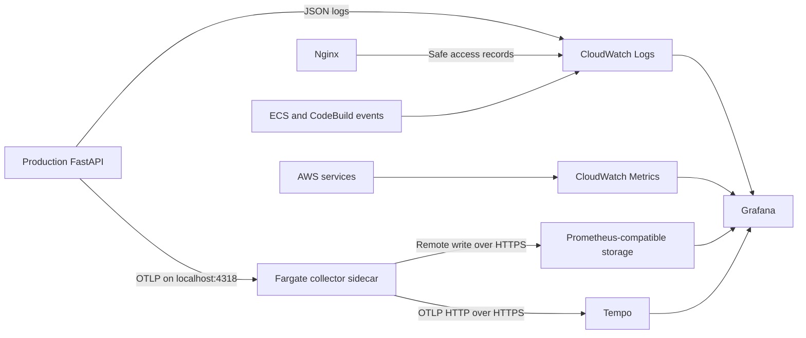

# Configure production logs, metrics and traces

This guide explains how to activate this repository's monitoring configuration.
It covers production and its shared delivery dependencies. Staging monitoring is
excluded, while the existing manual staging and production release approvals remain.

Run commands from the repository root unless a command specifies another directory.
Commands below are operator instructions; creating this guide does not apply AWS
infrastructure or deploy the application.

## 1. Understand where each signal goes

| Signal | Collection path | Investigation tool |
| --- | --- | --- |
| Application logs | Nginx/FastAPI stdout → ECS `awslogs` → CloudWatch Logs | CloudWatch Logs Insights or Grafana |
| Delivery logs/events | CodeBuild native logs; structured Jenkins events; independent GitHub/Jenkins job observations → CloudWatch Logs | CloudWatch or Grafana |
| AWS resource metrics | Native ECS, ALB, RDS, NAT and CodeBuild metrics → CloudWatch Metrics | CloudWatch or Grafana |
| Custom application metrics | FastAPI/SQLAlchemy → private OpenTelemetry collector → Prometheus remote write | Prometheus or Grafana |
| Application traces | FastAPI/SQLAlchemy → private OpenTelemetry collector → Tempo | Grafana Tempo data source |

**In this configuration, traces are stored in Tempo, not CloudWatch Logs.** A log
record containing a trace ID links evidence but does not store a complete trace.
Sending all three signals to AWS instead would require a separate change to the
trace destination and custom-metric collection; see section 12.



## 2. Prepare the backends and credentials

You need a deployed Prometheus-compatible backend, Tempo, Grafana, a Secrets Manager
secret and AWS identities with the scoped permissions described below.

Record four separate URLs:

| Input | Example only | Used by |
| --- | --- | --- |
| Metric ingestion | `https://metrics.example.invalid/api/v1/write` | Collector remote-write exporter |
| Metric query | `https://metrics-query.example.invalid` | Grafana Prometheus data source |
| Trace ingestion base | `https://traces.example.invalid` | Collector OTLP HTTP exporter |
| Trace query | `https://tempo-query.example.invalid` | Grafana Tempo data source |

Use the actual paths supplied by your backend. Ingestion and query endpoints may
be different. The Tempo exporter appends `/v1/traces` to its base URL; do not append
that suffix twice. The current Fargate security groups allow outbound HTTPS on
port 443. Keep receiver ports private and provide authenticated HTTPS ingress to
the external backends. Do not put credentials in endpoint URLs.

The repository also contains a separate **local** Prometheus instance:

```bash
docker compose -f observability/prometheus/compose.yml ps
```

Its query URL is `http://127.0.0.1:19090` and its remote-write URL is
`http://127.0.0.1:19090/api/v1/write`. These are local development addresses, not
addresses that AWS tasks can reach. Hosting/TLS/authentication must be established
before using this instance as a production destination.

In AWS Secrets Manager, create a secret in **eu-west-2** with this JSON structure:

```json
{
  "metrics_authorization": "<complete Authorization header value>",
  "tempo_authorization": "<complete Authorization header value>"
}
```

Use the authentication scheme required by each backend, such as a complete Bearer
or Basic header. Store actual values through the secret-management workflow, not
in Git, shell history, screenshots or Terraform variable values. Record the full
secret ARN. The current collector configuration supports these Authorization
headers; a backend requiring extra tenant headers or SigV4 needs an explicit
collector/authentication change before it will work.

## 3. Configure Terraform and review the infrastructure

Create a private, Git-ignored file such as
`infra/terraform/environments/production/observability.auto.tfvars.json`:

```json
{
  "production_telemetry": {
    "metrics_url": "https://metrics.example.invalid/api/v1/write",
    "tempo_url": "https://traces.example.invalid",
    "auth_secret_arn": "arn:aws:secretsmanager:eu-west-2:671662643382:secret:REPLACE"
  },
  "monitoring_runtime_expected": false
}
```

Replace the examples with real inputs. Leave `monitoring_runtime_expected=false`
until the application, probes and notification delivery have been verified.
The collector image has an immutable default in the Terraform module; review its
security and compatibility before release or supplying an alternative.

Retain the environment's existing sizing inputs and real `cloudfront_origin_token`.
Do not replace that origin token with an example value to make a plan succeed.

For GitHub-managed plans, configure repository variables:

- `PRODUCTION_TELEMETRY_JSON`: the JSON object inside `production_telemetry` above.
- `PRODUCTION_MONITORING_RUNTIME_EXPECTED`: `false` initially, later `true` after verification.

The workflow writes its production-only auto tfvars file before planning. Keep
GitHub and local inputs consistent; clearing these settings later can plan removal
of collector resources or permissions.

Run validation and generate **new** saved plans:

```bash
terraform fmt -check -recursive infra/terraform
terraform -chdir=infra/terraform/shared init -backend-config=backend.hcl
terraform -chdir=infra/terraform/environments/production init -backend-config=backend.hcl
terraform -chdir=infra/terraform/shared validate
terraform -chdir=infra/terraform/environments/production validate
terraform -chdir=infra/terraform/shared plan -input=false -out=/tmp/webtech-shared-review.tfplan
terraform -chdir=infra/terraform/environments/production plan -input=false -out=/tmp/webtech-production-review.tfplan
terraform -chdir=infra/terraform/shared show -no-color /tmp/webtech-shared-review.tfplan
terraform -chdir=infra/terraform/environments/production show -no-color /tmp/webtech-production-review.tfplan
```

Review resource creation/replacement, IAM/KMS policies, backend availability and
the full cost estimate. Protect saved plans because they can contain sensitive
values. The previously recorded plans proposed full stack creation, not small
changes to running production, and excluded collectors because inputs were missing.
They are not substitutes for plans made with your real backend settings.

**Stop for explicit approval before applying.** After approval, apply the exact
reviewed plans, shared dependencies first:

```bash
# Execute only after the corresponding plans have been reviewed and approved.
terraform -chdir=infra/terraform/shared apply /tmp/webtech-shared-review.tfplan
terraform -chdir=infra/terraform/environments/production apply /tmp/webtech-production-review.tfplan
```

## 4. Check roles and network access

| Identity | Required access |
| --- | --- |
| ECS execution role | Existing image/log delivery; read only the configured telemetry secret |
| ECS application task role | No extra AWS permission for the current HTTP metric/trace exporters |
| CodeBuild role | Native build log delivery and writes to the production pipeline-event log group |
| Jenkins identity | Existing deployment permissions plus exact SSM task-template parameter read and event log writes |
| External observer/checker | Event log writes; observer also has read-only Jenkins/GitHub API credentials |
| Grafana AWS identity | CloudWatch metric reads and scoped production/shared log queries |
| Annotation synchroniser | Read production deployment events and write Grafana annotations |

Review [Jenkins IAM additions](../observability/permissions/jenkins-observability.json)
and [Grafana AWS reads](../observability/permissions/grafana-cloudwatch.json).
These example policies are not attached automatically. If the telemetry secret uses
a customer-managed encryption key, add scoped `kms:Decrypt` access for its execution
role; the initial secret setup assumes the AWS-managed Secrets Manager key.

Verify backend DNS, TLS certificates and HTTPS reachability from the application
network. Do not open port 4318 on the public ALB: the app talks to its collector
through loopback inside the same Fargate task.

## 5. Configure and verify CloudWatch logs

Terraform configures log groups and task/project log settings; avoid manually
creating duplicate groups in the console.

| Log group | Evidence |
| --- | --- |
| `/ecs/webtech-production/frontend` | Nginx safe access records and permitted error output |
| `/ecs/webtech-production/backend` | Request outcomes, schema startup and sanitised database/application failures |
| `/aws/codebuild/webtech-shared-image-builder` | Native build/scan/push diagnostics |
| `/webtech/production/pipeline-events` | Delivery, observer and synthetic outcomes |
| `/webtech/production/ecs-events` | Native task/service/deployment lifecycle records |
| `/webtech/production/telemetry-collector` | Collector export/runtime errors, when configured |
| `/aws/rds/instance/webtech-production-postgres/postgresql` | Restricted PostgreSQL server diagnostics |
| `/webtech-production/vpc-flow-logs` | Network flow evidence |

WAF logs for the CloudFront-scoped web ACL are in **us-east-1**. Most application
resources/logs are in **eu-west-2**. ALB access logs remain in S3; they are not
automatically copied into CloudWatch Logs by this implementation.

After an approved release, inspect recent records:

```bash
aws logs tail /ecs/webtech-production/backend --since 15m --region eu-west-2
aws logs tail /webtech/production/telemetry-collector --since 15m --region eu-west-2
aws logs tail /webtech/production/pipeline-events --since 1h --region eu-west-2
```

In CloudWatch Logs Insights, select the backend group, choose the incident time
window, and run:

```text
fields @timestamp, event, route, status, error_type, request_id, trace_id, version
| filter event = "request.completed" or ispresent(error_type)
| sort @timestamp desc
| limit 100
```

For one request's trace:

```text
fields @timestamp, event, request_id, trace_id, error_type, version
| filter trace_id = "REPLACE_WITH_TRACE_ID"
| sort @timestamp asc
```

Logs Insights discovers fields in JSON log events. See the
[AWS query guide](https://docs.aws.amazon.com/AmazonCloudWatch/latest/logs/AnalyzingLogData.html).

Check that enquiry names/emails, credentials, request bodies and SQL values are
absent. Application logs retain safe exception types and stack-frame locations.
There is no separate migration runner today: schema creation emits startup events.
Raw Jenkins/GitHub console logs remain at their source; structured delivery events
and job outcomes are centralised.

## 6. Configure and verify metrics

AWS-managed metrics already have native CloudWatch namespaces:

| Namespace | Examples to inspect |
| --- | --- |
| `AWS/ECS` | Service CPU and memory |
| `AWS/ApplicationELB` | ALB/target errors and unhealthy hosts |
| `AWS/RDS` | Connections, CPU, free memory and storage |
| `AWS/NATGateway` | Port allocation errors |
| `AWS/CodeBuild` | Failed builds |
| `AWS/SQS` | Failed telemetry-delivery messages awaiting investigation |
| `WebTech/Production` | Metrics derived from synthetic, deployment and observer events |

In CloudWatch Metrics, choose eu-west-2 and the correct resource dimensions. No
application collector is required to scrape these native AWS measurements.

Custom request and pool metrics go to Prometheus through
[`production.yaml`](../observability/collector/production.yaml). The backend exports
OTLP HTTP to `http://127.0.0.1:4318`; the collector exports remote write using the
URL and secret header configured earlier. Do not add a second application scrape path.

Example PromQL queries:

```promql
# Production request rate by route/status
sum by (route, status) (rate(webtech_http_requests_total{environment="production"}[5m]))

# Connections currently checked out
sum(webtech_db_pool_in_use{environment="production"})

# Pool acquisition timeouts in the last five minutes
sum(increase(webtech_db_pool_timeouts_total{environment="production"}[5m]))

# HTTP p95 duration in seconds
histogram_quantile(0.95, sum by (le) (rate(webtech_http_request_duration_seconds_bucket{environment="production"}[5m])))
```

Allow time for export and multiple samples before evaluating rates. Prometheus's
own `up=1` only proves self-scraping; verify actual `webtech_*` series arrive.
If they do not, check the production enablement flag, sidecar presence, exporter
logs, endpoint path, authentication and backend ingestion permissions.

## 7. Configure and verify traces

The backend enables FastAPI and SQLAlchemy OpenTelemetry instrumentation, an
explicit `database.acquire` span and an `enquiry.save` operation. The collector's
`otlphttp/tempo` exporter forwards them to Tempo using the configured base URL.
See the [Tempo collector guide](https://grafana.com/docs/tempo/latest/set-up-for-tracing/instrument-send/set-up-collector/otel-collector/).

For a successful enquiry, expect an HTTP request span, a save operation and database
acquisition/query work. Acquisition spans expose time spent obtaining a connection;
they include queue waiting and connection setup, not only SQL execution.

Find `trace_id` in a production request log and look it up using Grafana's Tempo
data source. Compare its value with the response's `X-Trace-ID` header. Routine
traffic is sampled, so a log's trace ID does not guarantee that a trace was stored.
The external functional checker supplies sampled trace context for diagnosis.

CloudFront, ALB and Nginx do not automatically become complete application spans.
Their metrics and request records provide the evidence before FastAPI is reached.

## 8. Configure Grafana

Provision these files in the Grafana deployment:

- [Data sources](../observability/grafana/provisioning/datasources/production.yaml)
- [Dashboard provider](../observability/grafana/provisioning/dashboards/production.yaml)
- [Production dashboard](../observability/grafana/dashboards/production.json)

Set `PROMETHEUS_QUERY_URL` and `TEMPO_QUERY_URL` to query endpoints accessible from
Grafana. The supplied data sources assume unauthenticated internal query access;
configure secret-managed query authentication when your hosted backend requires it.
Use Grafana's AWS credential chain for CloudWatch, with the scoped read policy.

Obtain resource identifiers after apply:

```bash
terraform -chdir=infra/terraform/environments/production output -json observability
```

Set the dashboard's ALB and target-group suffix text variables from that output.
Check data-source connectivity, request/pool panels, CloudWatch AWS panels and the
request evidence table. Manual trace-ID lookup works without Loki; automatic
bidirectional links require separate Grafana correlation configuration.

For deployment annotations, schedule `observability/sync-annotations.py` with
`GRAFANA_URL`, a secret annotation-writer `GRAFANA_TOKEN`, and persistent
`ANNOTATION_STATE`. It reads production deployment events and writes native Grafana
annotations containing commit SHA and outcome.

## 9. Enable pipeline collection and independent checks

Only after reviewed infrastructure and permissions exist, set Jenkins parameter
`PRODUCTION_OBSERVABILITY_ENABLED=true`. Jenkins then uses the Terraform-generated
task templates from `/webtech-production/observability/task-templates` for the
approved production deployment. Terraform itself does not update active ECS service
application revisions. Both existing manual release gates remain required.

On a persistent host independent of the Jenkins agent, schedule these once per minute:

```bash
python3 observability/observe-delivery.py
python3 ci/production-functional-check.py --url https://YOUR-PRODUCTION-ORIGIN
python3 observability/sync-annotations.py
```

Configure observer credentials using [observer.env.example](../observability/observer.env.example)
and secure service-account environment management. Provide scoped AWS credentials
and `PRODUCTION_EVENT_LOG_GROUP=/webtech/production/pipeline-events` for observer
and checker exports. Give each worker a persistent writable working/state directory
and rotate its local spool files. Annotation sync additionally needs event-log reads.

Use read checks for recurring probes. A one-off enquiry write additionally requires
`--submit-once --cleanup-reference YOUR-TICKET`, with an established cleanup procedure.
These scripts are not installed as running services merely by applying Terraform.

## 10. Enable and test alert delivery

Subscribe and confirm the chosen destination on the SNS topic from the production
`observability` output. Test notification delivery through a controlled test route;
do not break production to make an alarm fire. Check alarm history for failed actions
and encryption/permission errors. SNS is encrypted with a customer-managed key
whose policy permits production CloudWatch alarm notifications.

The collector-error, failed CodeBuild and dead-letter delivery checks are independent
of the main runtime notification flag. Other runtime actions remain disabled while
`monitoring_runtime_expected=false`. After production, probes, observer heartbeats
and delivery are verified, set it to `true` through another reviewed Terraform plan.
Update the GitHub repository variable at the same time.

Load [application rules](../observability/alerts/production.yml) into your Prometheus
rule engine only when production is expected to run, and configure Alertmanager or
an equivalent notification receiver. The separate local Prometheus instance mounts
these rules but leaves them disabled initially. CloudWatch SNS setup does not
automatically configure Prometheus alert notifications.

## 11. Prove the setup and practise investigation

Record evidence that a normal request produces metrics, a safe JSON request record
and a sampled trace. Check a real approved release's commit SHA, digests, service
revisions, approval record and deployment annotation. Then follow the
[controlled validation guide](incident-drills/production-validation.md) for local
pool exhaustion, build-only failures and sanitised event fixtures.

Use the [Jira template](incident-template.md) to record symptom, timeline, evidence,
confirmed cause, fix and recovery checks. Automatic Jira creation is not configured.

| Symptom | First checks |
| --- | --- |
| No backend logs | Correct account/region, running task, `awslogs` group/options, execution-role and KMS permissions |
| Metrics missing but logs present | Exporter enablement, collector, HTTPS path/header, backend acceptance |
| Traces missing but metrics present | Sampling, Tempo exporter errors, OTLP base URL and trace-query destination |
| JSON logs have no trace ID | Instrumentation/middleware ordering, excluded health endpoint, correct release revision |
| No ECS events | EventBridge rule/target, log resource policy, encryption and dead-letter queue |
| Alarm visible but no notification | Actions enabled, subscriber confirmation, SNS/KMS permissions and action history |
| Grafana empty but backend query works | Grafana reachability/credentials, time range, region and resource dimensions |

Review [costs and permissions](../observability/README.md) before apply. Budget for
full infrastructure recreation as well as logs, queries, alarms, metric/trace
storage, hosting and network transfer. The documented small CloudWatch estimate
excludes the application's infrastructure baseline and external backend hosting.

## 12. If you want every signal in AWS

That is a different destination configuration. Keep the log path, but explicitly
design and validate an AWS trace path such as an appropriate OpenTelemetry collector
export to AWS X-Ray, including trace compatibility, sampling and task-role permissions.
Custom metrics would also need an explicitly supported CloudWatch ingestion path.
The current Tempo exporter and Prometheus remote-write exporter do not perform
those AWS exports. Avoid adding a second copy of every signal without a deliberate
need and cost review. This guide does not change the agreed destinations.

Supporting records: [current architecture](observability-design.md),
[implementation reference](../observability/README.md), and
[validation/plan record](observability-validation.md).
