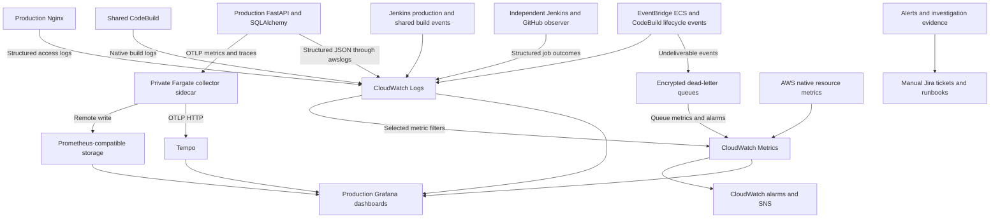

# Production monitoring and observability structure

CloudWatch remains the central operational log store. Prometheus-compatible
storage holds custom application metrics, Tempo holds application traces, and
Grafana brings the evidence together for incident investigation and Jira practice.

Status: implemented in repository configuration and tested locally. Infrastructure
has not been applied; production collection is not active.

## Scope and deployment boundaries

Monitor production application resources and the shared delivery dependencies
that build and deploy production releases. Exclude staging monitoring resources,
collectors, dashboards and drills. Preserve the existing staging and production
manual release approvals and promotion checks. Production deployment remains manual.

The application path is CloudFront/WAF → ALB → Nginx → FastAPI → PostgreSQL.
GitHub manages infrastructure checks and reviewed Terraform applies. Jenkins uses
CodeBuild/ECR to build and publish images, then promotes the approved image digests.

## Architecture



The external metric/trace backends and Grafana hosting still need to be selected.
The included Docker Compose stack is a local validation fixture with loopback-only
listeners, not production backend hosting.

## Signals and configuration

| Layer | Configuration in the repository |
| --- | --- |
| Metrics | FastAPI request counts, errors, duration and active requests; pool occupancy, acquisition duration, active acquisitions and timeouts |
| Collection | One private collector per production backend task; OTLP HTTP on task-local loopback, then remote write and Tempo export; no public metrics endpoint |
| Logs | Structured FastAPI/Nginx access records; native ECS and CodeBuild CloudWatch logs; schema-startup, deployment and delivery outcome records |
| Traces | FastAPI requests, SQLAlchemy database access, explicit connection acquisition and enquiry-save spans |
| AWS monitoring | ALB errors/unhealthy targets, RDS CPU/connections/memory/storage, NAT port allocation errors, CodeBuild failures, ECS lifecycle events and event-delivery failures |
| Grafana | Production data sources, application/database/AWS panels, request evidence, and deployment annotation synchronisation |
| Pipeline evidence | Commit SHA, build IDs, image digests, approval state/wait time, service revisions, deployment outcomes and observed rollback state |
| Independent checks | External HTTP functional checker, delivery-job reconciliation, observer heartbeats and overdue Jenkins run detection |

Application telemetry is enabled only for production. AWS metrics remain in
CloudWatch; they are not collected again through the application collector.
ALB access logs retain their native S3 destination.

## Correlation and privacy

Use commit SHA and image digests to connect a release to its deployed version.
Use request IDs and trace IDs to connect individual requests, logs and traces.
Keep release/run/trace identifiers out of metric labels; per-process instance IDs
separate measurements from concurrent backend workers.

Application logs and trace exports exclude enquiry values, request bodies, URL
queries, SQL statements/bind values, credentials and arbitrary exception messages.
Sanitised stack frames retain error type, file, function and line. Production
PostgreSQL logging suppresses statements/parameters and verbose error details.
Production Nginx restricts raw error logging and records safe access outcomes.

CloudWatch operational events and SNS notifications reuse the observability
customer-managed KMS key. Collector logs use the ECS logging key. Authentication
headers come from Secrets Manager, never repository files or task environment literals.

## Incident investigation and safe practice

Start with the alert/customer symptom, identify the relevant release or failed
stage, then inspect metrics, CloudWatch records and available traces. Record the
confirmed cause, fix and recovery evidence in a Jira ticket.

Run external read checks against the released production website. An enquiry
submission is an explicit one-off check requiring a cleanup reference. Exercise
pool exhaustion locally and use sanitised fixtures for disruptive failure cases.
Do not inject outages into production.

Raw Jenkins/GitHub console forwarding, automatic Jira creation, automatic
bidirectional trace/log links and live notification routing are not complete.
Structured delivery outcomes and evidence links are provided; operators configure
backend-specific authentication, correlation links and alert destinations.

## Repository layout

```text
observability/
  collector/                    # Production and local collector configurations
  grafana/                      # Data sources, dashboards and provisioning
  alerts/                       # Application metric alert rules
  queries/                      # CloudWatch investigation queries
  permissions/                  # Additive IAM policy examples
  observe-delivery.py            # Independent Jenkins/GitHub reconciliation
  sync-annotations.py            # Deployment events to Grafana annotations
  compose.yml                   # Local validation backends
app/backend/telemetry/           # Request, pool, log and trace instrumentation
ci/telemetry/                   # Structured delivery events and bounded export
ci/production-functional-check.py
infra/terraform/modules/observability/
infra/terraform/modules/ecs/observability.tf
infra/terraform/environments/production/
docs/runbooks/
docs/incident-drills/
docs/incident-template.md
```

## Activation sequence

1. Supply authenticated HTTPS metric remote-write and Tempo OTLP HTTP endpoints,
   their Secrets Manager authentication ARN, and the production backend/query setup.
2. Keep GitHub repository variables and local Terraform inputs consistent. Review
   scoped permissions, a complete cost estimate and fresh saved Terraform plans.
3. Apply only after explicit approval of those plans. Configure alert subscriptions
   and notification receivers, then enable the Jenkins production observability flag.
4. Deploy through the existing manual release gates. Verify Fargate export,
   CloudWatch events/logs, Grafana queries/annotations and external functional checks.
5. Schedule the observer, checker and annotation synchroniser independently of
   Jenkins. Enable runtime alarm actions through a reviewed plan after verification.

The saved review snapshot proposes 123 production and 17 shared resource creates,
with no updates/deletes. These recreate the application infrastructure baseline.
Collectors and runtime alarm actions are disabled in that snapshot because real
backend inputs have not been supplied. Generate a complete activation plan with
those inputs before applying infrastructure changes.

## Validation and supporting documents

Recorded checks include 34 application/pipeline tests, seven telemetry tests in
Python 3.12, three mocked Terraform boundary tests, local PostgreSQL/OTLP integration,
collector and Nginx validation, Prometheus rule checks, Ruff, Terraform validation
and a Checkov scan with zero failed checks and documented exceptions.

- [Step-by-step configuration guide](monitoring-configuration-guide.md)
- [Implementation, activation, costs and permissions](../observability/README.md)
- [Validation results and saved plan review](observability-validation.md)
- [Investigation runbook](runbooks/production-observability.md)
- [Controlled validation exercises](incident-drills/production-validation.md)
- [Jira incident template](incident-template.md)
- [Archived original proposal](observability-proposal.md)
