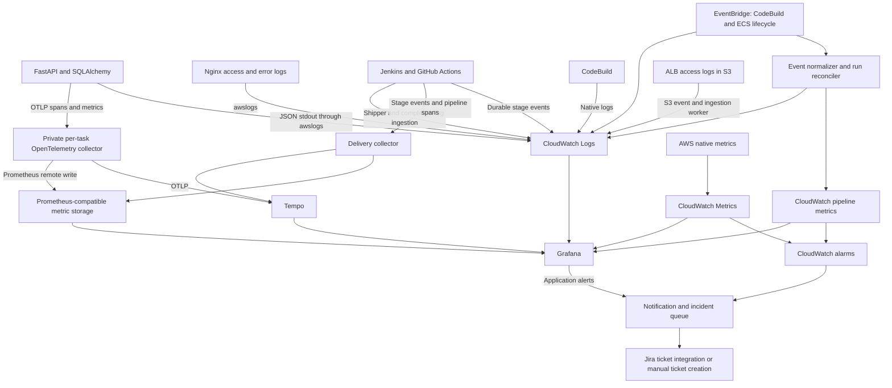

# Production monitoring and incident-practice design

Status: original proposed architecture, retained as design context. Implementation
configuration is now available; no infrastructure changes have been applied.

Implementation configuration and activation instructions now live in
[`observability/README.md`](../observability/README.md). This original proposal is
retained as design context; see the implementation guide and validation record
for delivered scope, live-state findings and unverified integration steps.

Scope: production application resources and the shared delivery components that
build or deploy production releases. Staging monitoring, collectors, dashboards,
alarms and drills are excluded. Preserve the existing release workflow and its
manual approvals; excluding staging from monitoring does not remove its existing
deployment approval or promotion checks. Do not deploy production automatically.
Changes to reusable modules or application images must be gated so staging does
not acquire collectors, exporters or new monitoring resources implicitly.

## Review of the proposal

Keep CloudWatch Logs as the central operational log store, Prometheus-compatible
storage for custom metrics, Tempo for traces, and Grafana for investigation.
Loki is unnecessary for the first implementation.

Add a delivery-observability layer alongside application observability. A failed
build, denied Terraform operation, lost Jenkins agent, expired approval, and failed
database connection need different evidence. Every run should have an outcome;
traces provide detail where instrumentation executes. No collector can guarantee
capture of every failure, especially when the collector or runner itself stops.
Independent lifecycle events and missing-event detection close those gaps.

## Existing configuration and gaps

| Area | Repository evidence | Addition needed |
| --- | --- | --- |
| ECS | `modules/ecs/task-definitions.tf` uses `awslogs`; production Container Insights enabled | Structured application logs, task/deployment lifecycle events, runtime alarms |
| CodeBuild | Shared project sends logs to CloudWatch | Events and metrics inside the build script, independent build-status capture, failed-scan diagnostics |
| PostgreSQL | PostgreSQL/upgrade log exports, enhanced monitoring, slow statements over 1 second | Pool instrumentation, lock diagnostics, connection budget, review current database monitoring options before implementation |
| Network and edge | VPC flow logs and WAF CloudWatch logging; ALB access logs in S3 | Failure dashboards, selected S3-to-CloudWatch ingestion, explicitly configure CloudFront request logging |
| Jenkins | Stage console logs, approval/result artifacts | Central log shipping, stage telemetry, controller heartbeat and external run reconciliation |
| GitHub Actions | Validation, security checks, Terraform plans/applies | Central job summaries/log ingestion and independent workflow completion capture |
| FastAPI | SQLAlchemy with implicit pool settings; database errors become HTTP 503 | JSON exception logs, explicit pool settings, metrics, tracing |
| Release checks | `/`, `/healthz`, `/api/health/db` smoke checks | Synthetic `POST /api/enquiries` and identifiable test-data cleanup |
| Observability module | Currently provisions encrypted VPC flow logs | Extend explicitly; its name does not mean dashboards, collectors or alarms already exist |

Paths above are relative to `infra/terraform/` unless stated otherwise.
The application creates tables at startup; a separate migration stage does not
currently exist. Instrument startup now and migration jobs when introduced.

## Signal flow



Use an ADOT/OpenTelemetry collector with explicitly supported receivers and
exporters, verified for the chosen distribution. A sidecar per backend task lets
the app export to localhost without exposing `/metrics` publicly or discovering
changing Fargate task IPs. Export custom metrics through OTLP initially. If using
the proposal's `/metrics` alternative, let the sidecar scrape localhost and avoid
publishing those same measurements through a second path.

Use separate delivery ingestion from application task sidecars so pipeline
telemetry works while ECS has zero tasks. Telemetry export needs bounded queues,
timeouts, retry and exporter health metrics; collector failure must not block an
application request. Choose persistent queues where supported and measure loss.

For a learning lab, Grafana, Prometheus and Tempo can start on a persistent lab
host, with authenticated TLS ingestion reachable by AWS collectors. Their uptime
then depends on that host. Keep CloudWatch alarms and lifecycle capture in AWS.
For an always-on version, evaluate hosted metric/trace backends against running
these services yourself. Choose hosting, retention and budget before provisioning.
Do not store long-lived telemetry only on ephemeral Fargate container storage.

## A contract for every delivery stage

Emit `stage.started`, `stage.completed`, `stage.failed`, `stage.timed_out`,
`stage.cancelled`, and explicit `stage.skipped` events. Approvals additionally emit
`approval.waiting`, `approval.granted`, `approval.rejected`, and
`approval.expired`. Record a final run event even if deployment never started.
An approval rejection is a release decision, not an application outage.

Use this common event shape, with optional fields omitted until known:

```json
{
  "schema_version": 1,
  "timestamp": "2026-11-01T12:00:00Z",
  "event_id": "jenkins:release:42:production-smoke:attempt-1:failed",
  "event_type": "stage.failed",
  "source": "jenkins",
  "service": "delivery",
  "environment": "production",
  "pipeline_run_id": "jenkins:release:42",
  "stage": "production-smoke",
  "attempt": 1,
  "commit_sha": "<full SHA>",
  "codebuild_id": "<project:build UUID>",
  "release_manifest_sha256": "<manifest hash>",
  "deployment_id": "<deployment identifier>",
  "trace_id": "<trace ID if available>",
  "outcome": "failed",
  "error_type": "database_unavailable",
  "duration_ms": 15003,
  "evidence_url": "<build or CloudWatch link>",
  "message": "Database smoke check returned HTTP 503"
}
```

Keep run IDs, commit hashes, task ARNs, trace IDs and image digests in logs/traces,
not metric labels. Metric dimensions should be bounded: pipeline, stage,
environment, service, outcome and a controlled error category. Derive metrics
from deduplicated events; retries and EventBridge redelivery must not double-count
failures. Do not count one ECS task failure as a second pipeline failure.

Builds before environment deployment use `environment=shared`; GitHub Terraform
runs use the affected stack. Assign run identity before checkout so checkout and
configuration failures are visible even without a commit or workspace.
Collect production and relevant shared build/plan events only. Filter ingestion
and dashboards accordingly; do not ingest staging job logs or stage events.

| Execution boundary | Evidence and capture |
| --- | --- |
| GitHub checks, plan, approval, apply | Step/job events, separate approval time, workflow/run/job IDs; export selected logs with redaction; completion webhook plus periodic API reconciliation |
| Jenkins checkout/configuration | Controller-level instrumentation and log shipper, independent of workspace and AWS credential binding in later stages |
| CodeBuild source/install/build | Native CloudWatch logs and EventBridge terminal build status, including failures before the build script starts |
| Docker build, frontend/backend scan, report upload, ECR push, manifest creation | Explicit substage events from `ci/build-images.sh`; one buildspec phase currently hides these distinctions |
| Production approval | Decision, wait duration, authorised actor and manifest identity, with controlled access to audit records; preserve all existing manual release gates |
| Task registration/service updates | Deployment events from `ci/deploy-ecs.py`, ECS task/deployment events, relevant CloudTrail API audit evidence |
| Stability and smoke checks | Expected and actual task revisions, each probe result and duration; distinguish circuit-breaker rollback, timeout and HTTP failure |
| Scaling activation and production promotion | Explicit outcome, same-digest verification, deployment annotation in Grafana |

Retain build IDs, image digests, stage outcomes, production approval states and
deployment results. Record rollback as `not_attempted`, `attempted`, `succeeded`,
`failed` or `partial`, with the affected service and before/after task revisions.
Verify actual service state rather than assuming a failed deployment rolled back.

Use Jenkins OpenTelemetry instrumentation for supported pipeline spans, then add
explicit events/custom instrumentation where required. Python and shell work in
CodeBuild does not automatically become child spans: propagate context explicitly
and instrument it. Keep raw console logs and compact structured stage events.

Pipeline traces and HTTP request traces serve different lifetimes. Link deployment
smoke-test traces to the pipeline via trace links/run metadata. Ordinary customer
requests get their own traces and a deployed commit/image identity; they should
not all be children of a deployment trace. Long approvals should have their own
events/durations rather than require a trace backend to hold a run open for hours.

External reconciliation checks for started runs with no terminal event, Jenkins
heartbeat loss, delivery collector failure and stopped synthetic probes. Query the
execution system before classifying a run as failed. Poll GitHub/Jenkins with
read-only scoped credentials; never assume a runner's final hook always executes.
Use retries and a dead-letter queue for ingestion workers, with alarms on both.

## Application instrumentation

FastAPI JSON logs should contain timestamp, severity, service, environment,
deployed version, route template, status, duration, request ID, trace ID and safe
exception type/stack. Log caught SQLAlchemy errors before returning the existing
503 responses; do not expose internal exceptions to the browser.

Instrument incoming FastAPI requests, SQLAlchemy/psycopg operations, outgoing HTTP
and the enquiry-save operation. Measure pool acquisition explicitly: query spans
alone do not explain time waiting for a connection. SQLAlchemy checkout events
alone also do not measure the preceding wait. Use a defined acquisition boundary
and record its duration and timeout outcome.

Nginx JSON access logs need status, upstream status, request time, upstream response
time and request ID. Forward request ID and W3C trace context to FastAPI. Edge and
Nginx logs remain useful without their own spans; a request rejected before the
backend may have no application trace.

Set pool size, overflow and acquisition timeout explicitly. Calculate:

`connection budget = maximum simultaneous backend tasks × worker processes per task × (pool_size + max_overflow) + other clients + reserved headroom`

Include deployment surge, not only the autoscaling maximum. Compare against the
actual database connection limit. Pool waiting and server connection exhaustion
are different failure modes and need separate alerts/runbooks.

Use route templates rather than raw URLs for metrics. Never export enquiry names,
emails, request bodies, credentials, SQL bind values or secret-bearing command
arguments. Review slow-query logging too: server logs can expose statement values
even when application traces redact them. Sanitise exception messages and stacks.

Configure explicit Grafana links/correlations from trace IDs to CloudWatch Logs
Insights queries and back to Tempo, carrying environment and time range. Do not
assume Tempo's built-in Loki trace-to-logs setup automatically queries CloudWatch.

Use a bounded production sampling policy, with explicit sampling of synthetic
checks where supported. Record sampling/drop rates. Unsampled requests still need metrics
and logs; a trace ID in a log does not guarantee a stored trace exists.

## CloudWatch logging layout

Retain the existing Terraform-owned log groups. Add groups such as:

```text
/webtech/shared/jenkins/controller
/webtech/shared/jenkins/pipelines
/webtech/shared/github-actions
/webtech/shared/pipeline-events
/webtech/production/ecs-events
/webtech/production/synthetics
/webtech/production/telemetry-collector
/webtech/production/alb-access
```

ALB access logs keep their native S3 destination. Add a deduplicating ingestion
worker if their searchable copy must be centralised in CloudWatch; the existing
bucket enables EventBridge but has no forwarding worker. Choose CloudFront's
supported request-log destination explicitly and forward if necessary. Check
regional placement: CloudFront-scoped WAF uses `us-east-1`, while the application
is in `eu-west-2`; configure Grafana queries and IAM for both.

Jenkins requires a shipper for controller and job logs, including controller-local
storage or a durable spool when AWS is temporarily unreachable. GitHub needs a
completion-driven ingestion worker to retrieve job logs, including failed jobs,
with periodic reconciliation for missed webhooks. Summary events are not a
replacement for diagnostic logs. Filter logs and cap size/retention deliberately.

Use 30-day production log retention as the initial repository
baseline. Give shared build logs explicit retention. Provision encryption and
separate write-only ingestion/read-only Grafana permissions. Keep CloudTrail as
the API audit source and link its evidence for IAM/deletion/configuration cases.

## Dashboards and initial alert rules

| Dashboard | Panels and first alert candidates |
| --- | --- |
| Delivery | Outcome by stage/system, active runs, stage duration, approval wait, last verified deployment; alert on failed build/apply/deploy, expected completion overdue, or heartbeat missing |
| Customer journey | Website availability, synthetic enquiry success, request rate/errors/latency; initially alert after two consecutive synthetic failures |
| Application and database | Request p95, 5xx ratio with minimum traffic, active requests, pool use/wait/timeouts, RDS connections and locks; pool timeout is actionable even at low traffic |
| ECS and network | Desired/running/pending tasks, unhealthy targets, stopped reasons, CPU/memory, ALB errors, NAT allocation errors and rejected flows |
| Telemetry health | Collector export failures/drops, last successful ingestion, reconciliation lag and dead-letter messages |

Treat thresholds as initial lab settings and tune them from measurements. Gate
availability alerts on the intended runtime state: this repository intentionally
starts with zero tasks and suspended scaling. An unreleased or deliberately paused
environment is not an outage. Do not use absence of traffic as proof of health.

Keep approval waiting separate from active execution duration. Annotate deployments
and drill start/end times. Use CloudWatch alarms for AWS/delivery signals and
Grafana alerts for custom application signals, with one notification route and
clear rule ownership to avoid duplicate tickets.

## Jira investigation practice

Start with manually creating tickets from alerts. Add automatic creation only
after event deduplication and ticket templates work. No Jira integration is assumed
to exist in this repository.

Each ticket should include environment, affected service/stage, observed customer
impact, first/last occurrence, run/deployment/commit IDs, expected versus actual
behaviour, dashboard/log/trace links, and the relevant runbook. Keep the suspected
cause separate from confirmed evidence. Group repeated alerts into one open
incident using environment + service/pipeline + failure category; record subsequent
occurrences and close after verified recovery.

| Production observability validation | Expected evidence | Resolution practice |
| --- | --- | --- |
| Introduce a Docker build error | Build substage failure, compiler output, failed CodeBuild status | Fix build, rerun, verify immutable release evidence |
| Trigger a security gate failure | Scan gate event and redacted finding summary | Assess vulnerability and patch; do not bypass the gate |
| Denied operation using an isolated test identity | Safely generated denial and API audit evidence | Identify required action/resource without changing live delivery permissions |
| Replay a sanitised unhealthy-task/deployment fixture | Test event processing, deployment outcome and dashboard links | Practise diagnosis and rollback evidence interpretation |
| Exercise pool exhaustion in a local disposable harness | Pool wait/timeouts, error metrics, acquisition spans | Verify instrumentation without exhausting the production database |
| Replay sanitised database connectivity failure evidence | Clearly marked test logs, metrics and trace evidence | Diagnose connectivity versus credentials/TLS |
| Simulate heartbeat/export failure through a test emitter | Test missing-event or telemetry alert | Verify detection without stopping live agents or collectors |
| Reject or expire an approval | Explicit decision event, skipped production deployment | Explain expected control behaviour without declaring an outage |

Every exercise needs a time limit, cleanup/revert command, expected alert and
recovery check. Mark synthetic fixtures and alerts as tests and keep their metrics
out of production SLO calculations. Run build/scan failure exercises in build-only
runs that cannot publish or deploy a release. Do not deliberately break production
tasks, database connections, networking, IAM or collectors. Fixture replay proves
processing and routing, not live failure capture; document that limitation.

Run a low-frequency external functional check against the production website,
health endpoints and `POST /api/enquiries`, using synthetic data, bounded timeouts
and no load generation. Define a narrowly scoped cleanup mechanism before enabling
repeated writes; the application currently has no synthetic-record cleanup path.
Confirm successful requests produce correlated logs, metrics and sampled traces.

## Proposed implementation structure and order

The paths below are proposed additions, not existing components:

```text
observability/
  collector/                  # Runtime and delivery collector configurations
  grafana/dashboards/          # Delivery, journey, database, infrastructure, telemetry
  grafana/provisioning/        # CloudWatch, metric and Tempo data sources
  alerts/                     # Rules, ownership and notification mapping
  queries/                    # CloudWatch Logs Insights and PromQL investigations
ci/telemetry/                  # Shared event schema and stage instrumentation helpers
app/backend/telemetry/         # Logging, tracing, pool and request metrics
infra/terraform/modules/observability/
                              # Extend: events, ingestion, alarms, dashboards and IAM
infra/terraform/shared/        # Wire shared delivery telemetry resources
infra/terraform/environments/production/
                              # Wire production telemetry resources only
docs/runbooks/                 # Symptom, evidence, diagnosis, fix, verification
docs/incident-drills/          # Injection, expected signals and cleanup
docs/incident-template.md      # Reusable Jira investigation template
```

1. **Reliable delivery evidence:** event schema, Jenkins/GitHub log ingestion,
   CodeBuild/ECS lifecycle capture, script substages, final outcomes, reconciliation
   and CloudWatch failure alarms. Preserve current release approval boundaries.
2. **Application diagnosis:** JSON logs and correlation, explicit pool configuration,
   OpenTelemetry metrics/traces, private collectors, Prometheus/Tempo and Grafana.
3. **Customer impact and drills:** enquiry synthetic, dashboards, runbooks and the
   controlled build checks, fixture replay and local database incident exercises.
4. **Ticket automation:** deduplication, routing, recovery handling and Jira creation.

Acceptance: demonstrate safe build-only failures and successful production
functional checks; use fixtures/local harnesses for deployment failure, database
failure, lost-agent and telemetry-outage scenarios without disrupting production.
For each, show either a terminal outcome or an explicit missing-telemetry alert,
usable CloudWatch evidence, correct correlation, and a verified recovery. Request
failures should additionally show metrics and traces when sampled. A security gate
or infrastructure failure need not produce an application trace.

Keep failed-scan evidence separate from release artifacts: the current build script
intentionally uploads reports only after both scans pass. Add a diagnostic summary
to CloudWatch without publishing `release.json` or making a failed build deployable.
No deployment, IAM, approval or release-artifact behaviour changes in this proposal.

## Costs, permissions and review gate

Before implementation, map the current production deployment and shared release
dependencies again, then reuse existing log groups and native metrics. Assign each
signal one collection path. Budget for collector CPU/memory, backend hosting and
storage, CloudWatch ingestion/retention/query scans/custom metrics/alarms,
synthetic execution, S3 forwarding, ingestion workers and network egress/NAT.
Provide a monthly estimate using expected traffic, retention and current regional
prices before provisioning; this proposal contains no priced estimate.

Provide exact scoped IAM changes with the implementation: application execution
roles for existing log delivery, collector roles for selected AWS exporters,
ingestion workers for specific log groups/buckets/queues, read-only GitHub/Jenkins
access, Grafana read access to production/shared CloudWatch sources, and Terraform
permissions for the proposed resources and limited role passing. Keep credentials
outside repository files and limit KMS access to the required keys and contexts.

Run applicable application/pipeline tests, collector configuration validation,
dashboard/alert validation, Terraform formatting and validation. Generate saved
Terraform plans for production and any changed shared stack; review IAM changes,
resource replacements and estimated costs. Verify staging has no infrastructure
or runtime monitoring changes. Present validation results and plans for review
before applying infrastructure changes. Apply only the reviewed plans after
explicit approval, and retain the existing manual production deployment approval.

## Implementation references

- [Jenkins OpenTelemetry plugin](https://plugins.jenkins.io/opentelemetry): pipeline tracing capabilities and setup requirements.
- [CodeBuild EventBridge events](https://docs.aws.amazon.com/eventbridge/latest/ref/events-ref-codebuild.html): independent build lifecycle signals.
- [ECS task state events](https://docs.aws.amazon.com/AmazonECS/latest/developerguide/ecs_task_events.html): task lifecycle and failure evidence.
- [Grafana trace correlations](https://grafana.com/docs/grafana/latest/datasources/tempo/configure-tempo-data-source/trace-correlations/): links from spans to related evidence.
