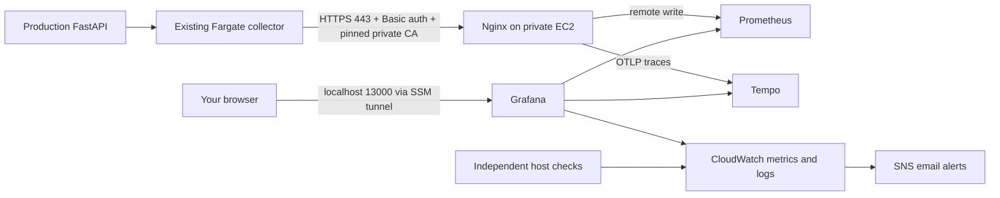

# Production monitoring on private EC2

This deployment is running; see `docs/monitoring-ec2-plan-review.md` for the
applied instance and validation record. Production application collection remains
a separate activation step. The
standalone Terraform root is `infra/terraform/monitoring`. It reuses the production
VPC/NAT, CloudWatch log encryption key, SNS email topic, dashboard, and Grafana
CloudWatch policy. It creates no staging resources and does not update ECS.



## Scope and storage

One Amazon Linux 2023 x86 instance, initially `t3.small` (2 vCPU, 2 GiB), private
IP, no public IP/SSH/internet ingress. HTTPS ingress permits only the production
backend security group. Grafana 3000, Prometheus 9090, and Tempo query 3200 bind to
host loopback; only Nginx ingestion 443 is available on the private interface.
Grafana still requires login. Administrators use SSM sessions and port forwarding.
No inbound SSM security group port is necessary; the existing NAT supplies AWS
API/image download connectivity. Containers have reduced RAM/swap limits totaling 1,344 MiB RAM. A 2 GiB
swap file on the encrypted root disk absorbs brief spikes; it is slower than RAM
and is not extra provisioned storage. About 704 MiB RAM remains for the OS, Docker,
SSM and CloudWatch agent. Go memory targets and Prometheus query concurrency are
bounded for light learning traffic. Heavy queries may be slow or restart services.
T3 standard CPU
credits avoid unlimited surplus-credit charges but sustained load can throttle.

The encrypted **20 GiB data EBS volume** is separate from the **20 GiB root
volume**, for **40 GiB total provisioned storage**. The data volume has
`prevent_destroy`. No automated snapshots, DLM policy, or backup IAM role are
created. Stop/start preserves data; instance replacement keeps its stable
ENI/private IP and reattaches the volume in the same availability zone. Terraform
stops the instance before detaching the disk. If the data volume is lost, there
is no automatic backup to restore. This is a single-server beginner learning
setup with downtime during failures/upgrades.

To leave room on the smaller disk, Prometheus retains three days or 5 GB of
blocks (WAL/head use additional space). Tempo 3 retains three days using its
supported backend scheduler flag; it has no disk size cap. A CloudWatch disk
alarm warns at 80%. Reduce traffic/retention or increase storage if it fills.
No duplicate span-metrics generator is enabled.

The local fixture remains separate, with Tempo 2; do not point it at these disks.
Pinned release images: Prometheus 3.16.0, Grafana 13.3.0, Tempo 3.1.1, Nginx 1.28
Alpine. Image upgrades require digest changes, validation/security scan, and review.
The Compose 5.7.0 binary is verified with its official release SHA256. Registry
availability and vulnerability scanning remain deployment prerequisites.

## Permissions and costs before approval

The operator needs read access for plan data sources (EC2 subnet/security group,
SSM public AMI parameter, caller identity) and the separate state object and lock
under `jenkins-pipeline/monitoring/` in the existing state bucket. Apply also needs
EC2 instance/ENI/security-group/EBS lifecycle and tags; IAM role/profile and inline
policy management and exact PassRole; KMS key/policy/rotation/grants; Secrets Manager
secret metadata; CloudWatch log-group/retention/encryption and alarm management. Current GitHub apply permissions were
scoped to app infrastructure and must not be assumed sufficient for this root.
This root is deliberately not added to the automatic GitHub apply workflow.

The EC2 identity uses AmazonSSMManagedInstanceCore, the existing read-only Grafana
CloudWatch policy, scoped monitoring log writes, custom metric writes restricted
to `WebTech/MonitoringHost`, and get/put only for its own credential secret plus
its storage key. Only trusted
administrators should control the host/containers: Grafana's EC2 credentials are
available through IMDSv2 with hop limit two, and all processes share one host trust
boundary. No long-lived AWS access keys are installed.

London EC2 on-demand Linux price verified through AWS Pricing on 2026-11-06:
`t3.small` is USD 0.0236/hour, approximately **USD 17.23 per 730-hour month for
compute alone**. Budget roughly **USD 25–40/month initially**, with the total
varying by 40 GiB provisioned gp3 storage, one KMS
key/requests, one secret/API requests, five alarms, custom metrics, CloudWatch logs
and queries, and traffic. This is an estimate, not a spending cap. Existing NAT
hourly charges are not duplicated, but image pulls/export/API bytes add NAT
processing charges. Cross-AZ bytes are possible because backend tasks span AZs.
Existing application costs, tax and discounts are excluded. EC2 stop reduces
compute charges but EBS, secrets and alarms still bill.

Sources: [EC2 pricing](https://aws.amazon.com/ec2/pricing/on-demand/),
[EBS](https://aws.amazon.com/ebs/pricing/), [CloudWatch](https://aws.amazon.com/cloudwatch/pricing/),
[SSM forwarding](https://docs.aws.amazon.com/systems-manager/latest/userguide/session-manager-working-with-sessions-start.html),
[Prometheus security](https://prometheus.io/docs/operating/security/),
[Tempo single-binary example](https://github.com/grafana/tempo/blob/v3.1.1/example/docker-compose/single-binary/tempo.yaml).

## Phase 1: review the backend plan, then explicitly approve apply

From the repository root:

```bash
cp infra/terraform/monitoring/terraform.tfvars.example infra/terraform/monitoring/terraform.tfvars
terraform -chdir=infra/terraform/monitoring init -backend-config=backend.hcl.example
terraform -chdir=infra/terraform/monitoring plan -out=/tmp/webtech-monitoring-ec2.tfplan
terraform -chdir=infra/terraform/monitoring show -no-color /tmp/webtech-monitoring-ec2.tfplan
```

The example has the production network IDs inspected during preparation. Refresh
IDs if that infrastructure is recreated. Verify the proposed subnet is private,
its route table uses the existing NAT, and no ingress other than backend SG 443 is
present. The monitoring state key must never reuse the production/shared state key.
Review the full plan and costs before applying it. Do not apply an earlier plan
after edits. Applying this root creates only monitoring resources; it does not
activate the app exporter or remove the Jenkins approvals.

## Phase 2: verify bootstrap and open Grafana

After approved apply, read `instance_id` from Terraform outputs. In AWS EC2,
select the instance and **Connect → Session Manager**, or run `aws ssm start-session`
with the instance ID. Install AWS's Session Manager plugin on your laptop for CLI
port forwarding. Your user needs `ssm:StartSession` on the monitoring instance and
the port-forward document, plus session ownership resume/terminate permissions.

Inside the instance, inspect (never paste passwords or full secret JSON in chat):

```bash
# Historical cloud-init status can retain an initial failure after an SSM repair.
sudo cloud-init status --wait
sudo systemctl status webtech-monitoring
sudo docker compose --project-directory /srv/webtech-observability ps
sudo cat /run/webtech-monitoring-health
```

Read host/container logs in `/webtech/production/monitoring-host` in CloudWatch.
Bootstrap fails closed if package/image pulls fail; resolve the error through SSM
and rerun the reviewed bootstrap/recovery process instead of assuming apply success
means services are ready. Initial alarms may report missing data during bootstrap.
The disk/health alarms must clear once the host is ready.

From the repository root, run:

```bash
bash observability/ec2/open-grafana.sh
```

Keep that terminal open, then browse **http://127.0.0.1:13000**. The helper uses
the instance output and supports the Session Manager plugin in `~/.local/bin`.
Alternatively use the `grafana_tunnel` command printed by Terraform. Login is `admin`; obtain only
the `grafana_admin_password` field of the generated secret in your own secure
terminal/Secrets Manager console. Never copy that value into GitHub variables or
Terraform inputs. Grafana's provisioned production data sources and dashboard
reuse `observability/grafana`. CloudWatch uses the EC2 IAM role, without API keys.
If port 13000 is occupied, choose a different local port in the tunnel command.

For direct Prometheus queries, use a separate SSM forwarding session with remote
port 9090 and local port 19091, then open http://127.0.0.1:19091. This is the EC2
Prometheus; http://127.0.0.1:19090 remains your independent local instance. Empty
app queries are expected before Phase 3.

## Phase 3: activate ECS collection using a second reviewed production plan

The host creates one secret version with `metrics_authorization`,
`tempo_authorization`, `ca_pem`, and `grafana_admin_password`; Terraform manages
only secret metadata. You do **not** need to buy a certificate, own a domain, or configure ACM.
The host generates a free private self-signed TLS certificate with the stable IP
in its SAN. The collector pins the public certificate from the secret, verifies
host identity, and continues to use encrypted HTTPS. Never set insecure_skip_verify.
The EC2 host's Basic authorization header is accepted only on the two ingestion
routes, not on a public query/admin endpoint.

Copy the non-secret JSON output `production_telemetry` into the GitHub repository
variable `PRODUCTION_TELEMETRY_JSON`. It contains endpoint URLs, secret ARN, storage KMS key ARN, and
`"use_private_ca": true`; it contains no credentials/certificate private key.
Keep `PRODUCTION_MONITORING_RUNTIME_EXPECTED=false` until probes/observers are
ready. Generate and review a new production plan; approve its task template/secret
read and scoped Secrets Manager KMS decrypt changes through the normal GitHub production approval. Code changes must
first be committed/reviewed so the workflow understands `use_private_ca`.

Then run Jenkins with `PRODUCTION_OBSERVABILITY_ENABLED=true`, using both existing
manual staging and production approvals. The production task uses the exact
Terraform templates; staging monitoring remains disabled. Enabling the flag
before the secret version and task-template SSM parameter exist will fail.

Verify safe external functional checks, then query `{__name__=~"webtech_.*"}` in
the EC2 Prometheus and open the existing production dashboard in Grafana. Make
several safe GET requests before checking Tempo because traces are sampled at
10%. Use returned X-Trace-ID and log IDs to correlate. Confirm CloudWatch logs
continue receiving app/delivery logs. Test invalid auth (401), valid auth with
invalid payload (a backend parse error, not 401), and trusted TLS; never export
customer data as a test. App data arriving is separate from `up=1` self-monitoring.

## Alerts and operations

Five host alarms (EC2 CPU/status, disk, readiness heartbeat, TLS certificate days
remaining) publish to the already-tested SNS topic. They use the
`webtech-production-` prefix accepted by its encryption key. Instance probes run
every minute, alarms evaluate five-minute periods twice. An instance outage can
prevent probes; missing-data evaluation is the independent CloudWatch fallback.
These checks measure service readiness, not end-to-end ingestion durability.

Application alert rules are provided as `alerts.yml` but remain disabled. A
running Prometheus/Grafana stack alone does not send application email. Configure
one alert owner (Alertmanager or Grafana Alerting) and its receiver, test delivery,
then enable canonical rules after data is present. Do not run duplicate rules in
both. Existing AWS alarms remain CloudWatch → SNS → email. The production deployment-annotation sync is installed on the monitoring host
and runs every minute. Its Editor service-account token remains server-side and
in the existing Secrets Manager record; rotate/revoke it through Grafana when
required. Existing external synthetic checks and GitHub/Jenkins delivery observers
still need scheduling with their documented credentials. Commit/resource labels remain available on the dashboard.

Before enabling runtime alarms via the reviewed GitHub variable, ensure scheduled
probes/observer heartbeats work and review the existing RDS memory alarm. Do not
simulate production outages merely to prove notification routing.

No automated snapshots are configured, as requested. `prevent_destroy` protects
the data volume from ordinary Terraform destruction; it is not a backup against
failure or accidental deletion outside Terraform. Treat this learning telemetry
as disposable. Deleting the stack is intentionally blocked until explicit data
volume removal is reviewed. A retained volume still incurs storage charges.

The certificate expires after one year; the 30-day warning gives time for a
coordinated renewal. Back up TLS files and credential JSON securely, renew the
certificate with the same IP SAN, update `ca_pem` in the secret, restart Nginx, and
perform an approved production ECS rollout to refresh its pinned certificate.
Plan for the trust transition; do not delete/replace the stable ENI casually.
Credential rotation similarly needs nginx htpasswd and both complete Basic headers
updated together, followed by an approved ECS rollout. Changing the Grafana secret
file alone does not reset an existing Grafana database password; change that
password using Grafana's supported admin flow and synchronize the secret record.
